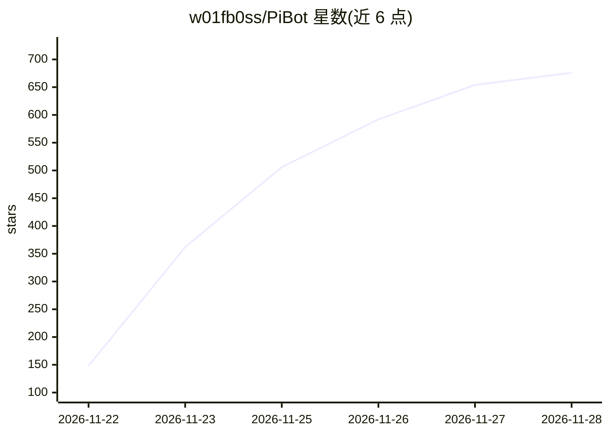

# w01fb0ss/PiBot

⭐ 676 · TypeScript · Apache-2.0 · 推送 2026-11-27 · [GitHub](https://github.com/w01fb0ss/PiBot) · [官网](https://pibot.space) · 个人维护 · 中文 README

**本地优先的桌面多 Bot 协作 Agent 团队应用**

Pi Bot 是一个 Electron 桌面应用，在本机运行一组具名 Bot：单聊或群聊，Bot 可规划、执行命令、编辑文件、浏览网页与操作电脑，风险步骤需用户审批。群聊由协调者拆解任务并分派给成员。数据、记忆与密钥保留本地，模型经用户自选的提供方调用。支持 Ollama 本地模型、OpenRouter、自有 API key 与订阅登录；含定时/触发式任务、MCP 连接、审计日志与沙箱。提供 macOS/Windows/Linux 安装包及 Android 应用，可从源码构建。

## 筛选速览

| 维度 | 判定 | 备注 |
|---|---|---|
| AI 角色 | `ai-native` | 本体是模型或模型工具 |
| 许可风险 | `permissive` | Apache-2.0 |
| 部署形态 | `library` | 以包/库形式分发 |
| 模型依赖 | local-ok | 支持本地模型 |
| 硬件要求 | — | 无带数字的原话,不猜 |
| 安装摩擦 | `low` | 无编译、无系统依赖或容器化 |
| 成熟度 | — | 结构信号不足 |

## 能力要点

- 多 Bot 群聊协作：协调者规划并分派任务，用户确认后执行
- 统一策略引擎审批每次工具调用，命令在沙箱运行并写入审计日志
- 本地优先：对话、文件、记忆与密钥留在本机
- 支持 Ollama 本地模型、OpenRouter、自有 API key 与订阅登录

## 适用场景

- 在本地桌面让多个 AI Bot 协作完成编码、调研、写作任务
- 需要每步审批与审计日志的自动化电脑操作
- 用本地模型保持数据不出机器的 Agent 工作流
- 通过定时与文件夹触发任务实现例程自动化

## 场景标签

`多智能体` `AI 助手` `GUI 自动化` `编码 Agent` · 领域:Agent 开发

## 证据(README 行号)

> L3: **An open-source, local-first AI agent team for your desktop.** Named AI Bots work on your own
> L21: Pi Bot is a desktop app in which a team of named Bots works on your own computer. You chat with a
> L42: - **Models.** Local models through Ollama, OpenRouter, your own API keys, and supported

## 星数曲线

2026-11-22 148 → 2026-11-28 676（+528）

---
*卡片 v1 · prompt 1.4 · 生成 2026-11-27 · 置信度 high · 依据 README sha `5b4185aa049e` · [字段定义](../../DATASET.md)*
