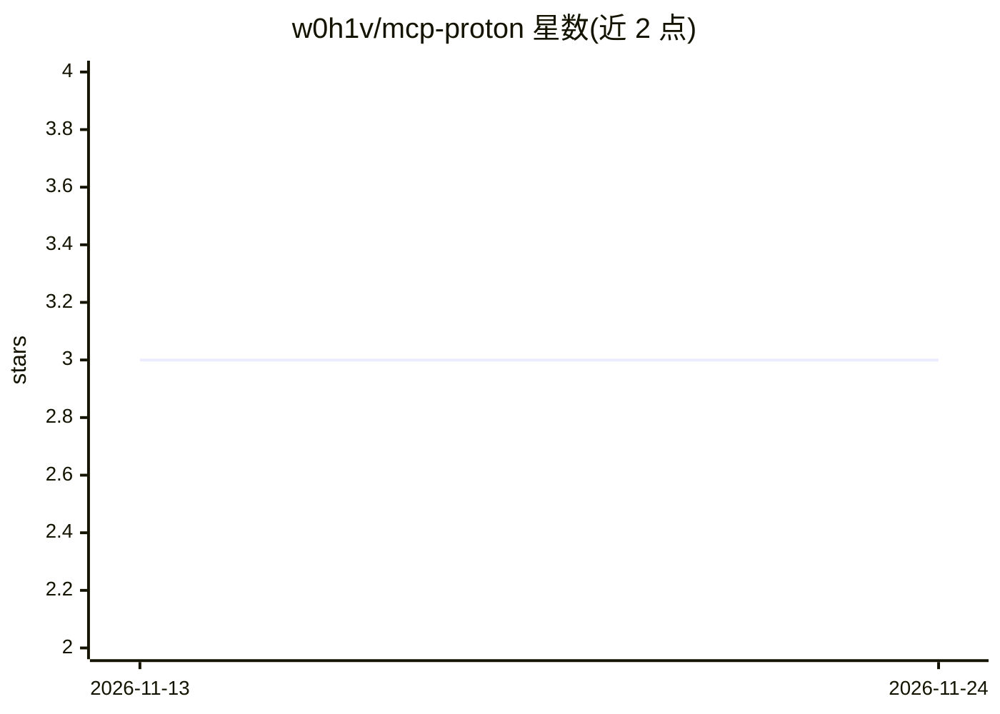

# w0h1v/mcp-proton

⭐ — · [GitHub]() · 个人维护

**策略控制的 MCP 服务器：让 AI agent 受限访问 Proton Mail**

通过 Proton Mail Bridge 向 AI agent 开放邮件能力的 MCP 服务器，按动作（读取、整理、草稿、发送、删除）配置 Allow/Ask/Deny 策略，支持按客户端/账户/邮箱覆盖、临时授权与到期自动收回。发送类操作绑定精确请求内容，批准后内容变更即失效；所有写操作进入审计日志。需付费 Proton 账户、Bridge 与 Python 3.11+，当前为 beta，回信路径与 Linux/Windows 未实测，能力需对本机 Bridge 运行探针后才报告 available。

## 筛选速览

| 维度 | 判定 | 备注 |
|---|---|---|
| AI 角色 | `ai-ecosystem` | LLM/agent 周边工具 |
| 许可风险 | `permissive` | — |
| 部署形态 | `library` | 以包/库形式分发 |
| 模型依赖 | — | README 未给出锁定关系 |
| 硬件要求 | — | 无带数字的原话,不猜 |
| 安装摩擦 | `low` | 无编译、无系统依赖或容器化 |
| 成熟度 | `idea` | |

## 能力要点

- 按动作的 Allow/Ask/Deny 策略与按客户端/账户/邮箱覆盖
- 批准绑定精确请求（收件人、内容、消息），agent 无法自批
- 所有写操作记录审计日志，含部分结果
- 无 AI 调用、无遥测，仅与 Bridge 及请求方通信

## 适用场景

- 让桌面 MCP 客户端里的 agent 读写邮件但发送需人工批准
- 通过隔离服务部署，让远程 agent 走认证 HTTP 访问邮箱
- 用接收方域名白名单限制自主模式的邮件外发

## 场景标签

 · 领域:AI Agent 工具/邮件

## 证据(README 行号)

> L17: **mcp-proton** is an MCP server that gives AI agents access to Proton Mail through Proton Mail Bridge. You decide w
> L31: - **No AI calls, no telemetry.** The service talks only to Bridge, to the MCP client that asked, and to webhook des

## 星数曲线

2026-11-13 3 → 2026-11-24 3（+0）

---
*卡片 v1 · prompt 1.4 · 生成 2026-11-22 · 置信度 high · 依据 README sha `a3fd9d42f9cc` · [字段定义](../../DATASET.md)*
