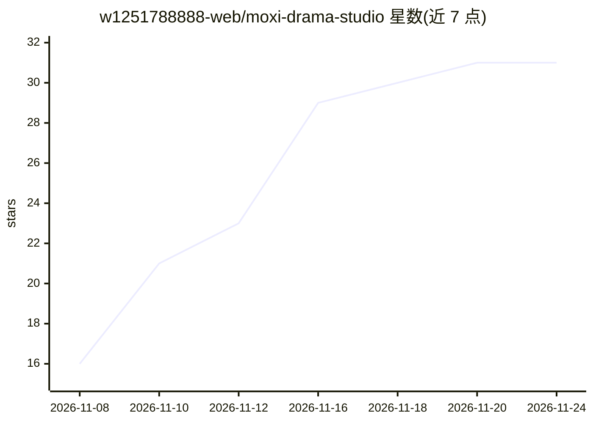

# w1251788888-web/moxi-drama-studio

⭐ 31 · JavaScript · NOASSERTION · 推送 2026-11-08 · [GitHub](https://github.com/w1251788888-web/moxi-drama-studio) · 个人维护 · 中文 README

**给短剧编剧的本地创作工作台：一句话故事到可导出剧本**

跑在 DeepSeek Harness（本地 Agent 运行时）上的短剧创作插件集，含 moxi-core 业务内核、无限画布与管理后台三个 bundle。把短剧创作拆成可复跑流水线：概念→角色→节拍→分场→剧本→确定性检查→可拍性报告→逐集签收→人工放行→导出 docx，单任务上限 30 集。分工上模型负责写与打分，字数/场次/合规/钩子等判定由脚本算，放行留给人。数据全存本机文件，无云端后端与遥测。许可为 PolyForm Noncommercial：个人非商业免费，商用需授权。

## 筛选速览

| 维度 | 判定 | 备注 |
|---|---|---|
| AI 角色 | `ai-native` | 本体是模型或模型工具 |
| 许可风险 | `none` | NOASSERTION |
| 部署形态 | `library` | 以包/库形式分发 |
| 模型依赖 | locked-api |  |
| 硬件要求 | — | 无带数字的原话,不猜 |
| 安装摩擦 | `low` | 无编译、无系统依赖或容器化 |
| 成熟度 | `idea` | |

## 能力要点

- 1–30 集一键直出，支持断点续跑与生成前快照回退
- 确定性检查与可拍性报告（时长/场次/钩子），签收绑定稿件版本
- 放行闸门：未签收/签收失效/缺钩子不放行，强制放行需填理由并写审计
- 96 个规则包文件 + 创作技能 + 74 项离线评测集随源码入库

## 适用场景

- 小型短剧工作室批量出稿并跑质量门
- 把创作规则沉淀成规则包资产的个人编剧
- 想参考 DSH 插件写法的开发者
- 对数据隐私有要求、需要全本地存储的创作流程

## 场景标签

`AI 写作` · 领域:内容生成

## 证据(README 行号)

> L18: 墨戏生花（Moxi）是一个跑在 DeepSeek Harness 上的短剧创作插件。DSH 是 DeepSeek 的本地 Agent 运行时（「一切皆插件」），墨戏生花以三个插件的形式接入它。它把「写短剧」拆成一条可复跑的流水线，
> L3: > **跑在 DeepSeek Harness 上的短剧创作工作台（源码公开 · 个人非商业免费）：在无限画布上，把一部短剧从一句话故事写到可导出 docx，再判断它到底能不能拍。**
> L21: 新建剧作 → 概念设定 → 角色资产 → 分集节拍 → 分场表 → 剧本

## 星数曲线

2026-11-08 16 → 2026-11-24 31（+15）

---
*卡片 v1 · prompt 1.4 · 生成 2026-11-18 · 置信度 mid · 依据 README sha `a69584ad2280` · [字段定义](../../DATASET.md)*
