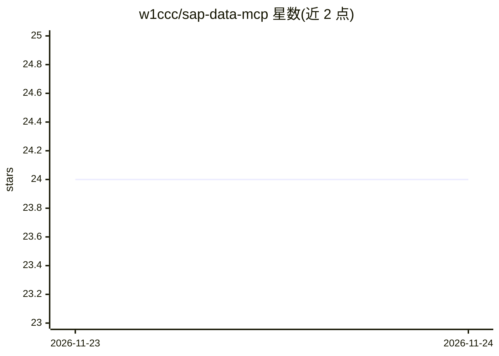

# w1ccc/sap-data-mcp

⭐ 92 · Python · MIT · 推送 2026-11-22 · [GitHub](https://github.com/w1ccc/sap-data-mcp) · 个人维护 · 中文 README

**给 AI 助手开只读账号查 SAP S/4HANA 的 MCP 服务**

由三个只读 MCP 服务组成，分别通过 RFC/BAPI（PyRFC + SAP NW RFC SDK）、私有云 OData V2/V4 和公有云 Released API 接入不同形态的 S/4HANA，合计注册 412 个只读 Tool，覆盖 MM/IM、PP、SD、FI、CO 等 8 大标准模块。安全机制包括 RFC 函数白名单（98 项）、仅 GET 请求、凭证只存本机 .env 并在日志中脱敏、每次调用写入 jsonl 审计日志。结果保留 SAP 原始字段与状态标记（ok/not_found/partial/error）。

## 筛选速览

| 维度 | 判定 | 备注 |
|---|---|---|
| AI 角色 | `ai-ecosystem` | LLM/agent 周边工具 |
| 许可风险 | `permissive` | MIT |
| 部署形态 | `desktop` | 安装包/桌面程序 |
| 模型依赖 | — | README 未给出锁定关系 |
| 硬件要求 | — | 无带数字的原话,不猜 |
| 安装摩擦 | `low` | 无编译、无系统依赖或容器化 |
| 成熟度 | — | 结构信号不足 |

## 能力要点

- 三个服务共 412 个只读 Tool，覆盖 8 大标准模块
- RFC 调用经 98 项只读函数白名单，HTTP 仅发固定 GET 请求
- 凭证只存本机 .env，日志中显示为 [REDACTED]
- 每次调用写审计日志，可用 get_tool_call_log 回看

## 适用场景

- 用中文直接问 AI 助手订单、发票、库存、供应商未清项
- 让 AI 查询短转储、后台作业、IDoc 等系统监控信息
- 在不想给 AI 写权限的 SAP 环境中提供只读数据访问

## 场景标签

 · 领域:企业应用/ERP 数据接入

## 证据(README 行号)

> L7: 让 Claude 等 AI 助手只读查询 SAP S/4HANA 的 MCP 服务，RFC/BAPI、私有云 OData、公有云 API 都能接
> L47: |**自己写脚本调 RFC 或 OData**|每个新问题都要写代码、处理认证和分页，脚本里还常常带着密码|三个服务共 412 个现成的只读 Tool，认证和分页都处理好了，凭证只放在本机 `.env`|

## 星数曲线

2026-11-23 24 → 2026-11-24 24（+0）

---
*卡片 v1 · prompt 1.4 · 生成 2026-11-23 · 置信度 high · 依据 README sha `4de33d6a1a9a` · [字段定义](../../DATASET.md)*
