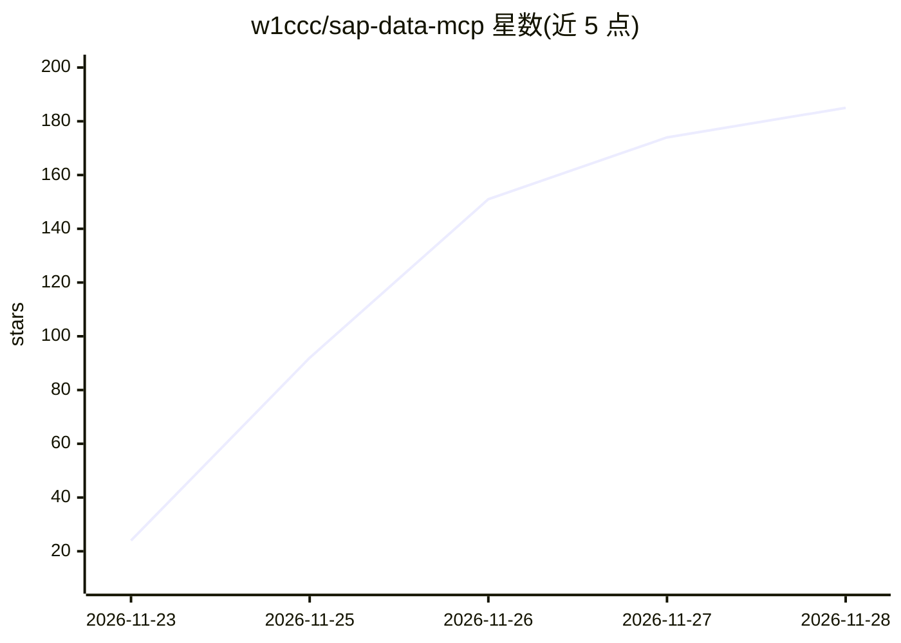

# w1ccc/sap-data-mcp

⭐ 185 · Python · MIT · 推送 2026-11-27 · [GitHub](https://github.com/w1ccc/sap-data-mcp) · 个人维护 · 中文 README

**让 Claude 等 AI 助手只读查询 SAP S/4HANA 的 MCP 服务**

由三个只读 MCP 服务器组成，分别通过 RFC/BAPI（PyRFC + SAP NW RFC SDK）、私有云 OData V2/V4 和公有云 Released API 接入不同形态的 SAP S/4HANA，合计注册 412 个只读 Tool，覆盖 MM/PP/SD/FI 等 8 大模块。安全机制包括 RFC 白名单（98 个标准读取函数）、凭证只存本机 .env、TLS 校验、每次调用写审计日志。不支持任何写入操作；RFC 部分需额外安装 SAP NW RFC SDK。

## 筛选速览

| 维度 | 判定 | 备注 |
|---|---|---|
| AI 角色 | `ai-ecosystem` | LLM/agent 周边工具 |
| 许可风险 | `permissive` | MIT |
| 部署形态 | `desktop` | 安装包/桌面程序 |
| 模型依赖 | — | README 未给出锁定关系 |
| 硬件要求 | — | 无带数字的原话,不猜 |
| 安装摩擦 | `low` | 无编译、无系统依赖或容器化 |
| 成熟度 | — | 结构信号不足 |

## 能力要点

- 三个服务合计 412 个只读 Tool，覆盖 8 大标准 SAP 模块
- RFC 调用经 98 个标准读取函数白名单，无任何写入能力
- 凭证仅存本机 .env，错误与日志中显示为 [REDACTED]
- 每次调用写入 jsonl 审计日志，可回看参数与耗时

## 适用场景

- 用中文向 AI 助手查询采购订单、发票与供应商未清项
- 排查 IDoc、后台作业与短转储等系统运行状况
- 在不开放写入权限的前提下让 AI 查询企业 ERP 数据

## 场景标签

 · 领域:企业软件/ERP 数据接入

## 证据(README 行号)

> L7: 让 Claude 等 AI 助手只读查询 SAP S/4HANA 的 MCP 服务，RFC/BAPI、私有云 OData、公有云 API 都能接
> L11: **一句话理解**：如果把 AI 助手看成一位新同事，SAP Data MCP 就是给它开的一个**只读账号，外加一本操作手册**：订单、发票、库存、供应商未清项，它都能自己去 SAP 里查，再用一句话把结论告诉你；但它改不了任何
> L59: - **用你已经在用的 AI 工具**：Claude Desktop、Claude Code、Cursor 等支持 MCP 的客户端都能直接连，不需要另外搭平台或写 Agent。

## 星数曲线

2026-11-23 24 → 2026-11-28 185（+161）

---
*卡片 v1 · prompt 1.4 · 生成 2026-11-27 · 置信度 mid · 依据 README sha `ec2403b8ace8` · [字段定义](../../DATASET.md)*
