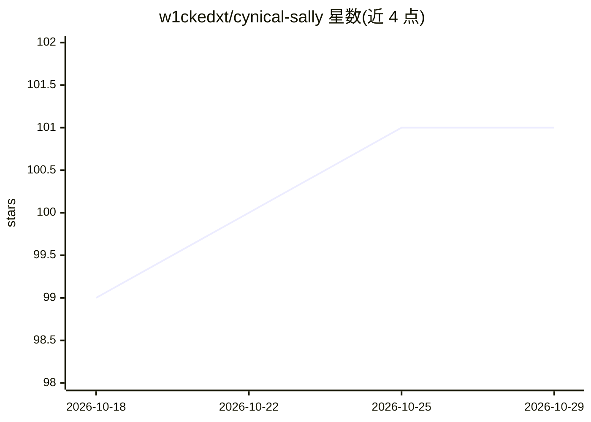

# w1ckedxt/cynical-sally

⭐ 101 · TypeScript · MIT · 推送 2026-07-04 · [GitHub](https://github.com/w1ckedxt/cynical-sally) · [官网](https://CynicalSally.com/fullsuite) · 个人维护

**给开发者的终端/AI 编辑器代码审查 CLI 与 MCP 工具**

以 CLI 与 MCP server 两种形式提供的 AI 代码审查工具，可接入 Claude Code、Cursor、Windsurf。核心功能 roast 对文件、目录或 git 变更给出 0-10 评分、带证据的问题与可用的修复；另有 explain、refactor、review-pr、brainstorm、frontend、marketing 等命令，以及仓库评分与 README 徽章、CI 集成（--fail-under/--json）。通过 npm 全局安装，要求 Node.js 18+。代码经 HTTPS 上传实时分析（走 Anthropic API），提供 --dry-run 打印确切载荷与 SHA-256 回执，本地跳过密钥文件；免费额度为每月 90 次 roast，其余工具各含 1 次免费试用，付费解锁 Full Suite。

## 筛选速览

| 维度 | 判定 | 备注 |
|---|---|---|
| AI 角色 | `ai-native` | 本体是模型或模型工具 |
| 许可风险 | `permissive` | MIT |
| 部署形态 | `library` | 以包/库形式分发 |
| 模型依赖 | locked-api |  |
| 硬件要求 | — | 无带数字的原话,不猜 |
| 安装摩擦 | `low` | 无编译、无系统依赖或容器化 |
| 成熟度 | — | 结构信号不足 |

## 能力要点

- roast 输出 0-10 评分、证据化问题与修复建议，支持 staged/diff 模式
- CLI 与 MCP server 双形态，接入 Claude Code、Cursor、Windsurf，暴露 8 个 MCP 工具
- --dry-run 展示将上传的完整载荷并生成 SHA-256 回执，密钥文件上传前本地跳过
- CI 集成（--ci/--fail-under/--json）与仓库评分徽章

## 适用场景

- 在终端或 AI 编辑器里对代码改动做评分式审查
- 在 CI 流水线中按分数阈值拦截低质量代码
- 让 AI 编辑器内的 agent 通过 MCP 调用审查、解释、重构工具

## 场景标签

`代码审查` · 领域:编码与开发

## 证据(README 行号)

> L28: She's the senior engineer your code hoped it'd never meet. Scores from 0 to 10, real issues backed by evidence, and
> L319: - **Never trained on, sold, or shared.** Analysis runs through Anthropic's API, which doesn't train on submitted c

## 星数曲线

2026-10-18 99 → 2026-10-29 101（+2）

---
*卡片 v1 · prompt 1.4 · 生成 2026-10-23 · 置信度 high · 依据 README sha `37948971ed7c` · [字段定义](../../DATASET.md)*
