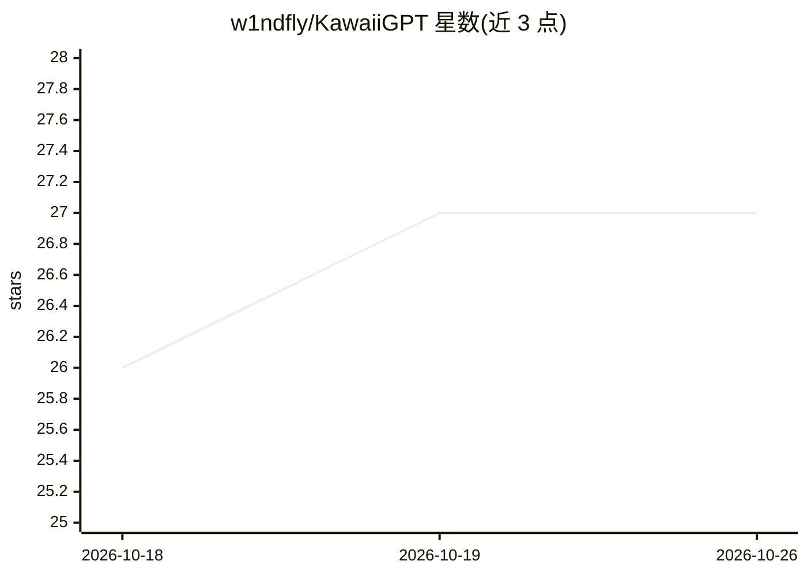

# w1ndfly/KawaiiGPT

⭐ 27 · Python · MIT · 推送 2025-12-06 · [GitHub](https://github.com/w1ndfly/KawaiiGPT) · 个人维护

**自称无需 API Key 的 GPT 聊天工具（WormGPT 可爱版）**

作者 Shoukaku07/MrSanZz 发布的 GPT 类工具，README 自称无需 API Key 即可使用，附一个 LIC 码，提供 Linux（apt 安装 python3/pip/git）与 Termux（pkg 安装）两类环境下的运行步骤，含语音功能提示（遇 ALSA lib 错误时勿启用）。代码经过混淆，作者称混淆目的是防止他人改写和转卖，并声明不含恶意代码。README 未说明模型来源、功能细节与许可条款，且明确禁止修改或出售该工具。

## 筛选速览

| 维度 | 判定 | 备注 |
|---|---|---|
| AI 角色 | `ai-native` | 本体是模型或模型工具 |
| 许可风险 | `permissive` | MIT |
| 部署形态 | `None` |  |
| 模型依赖 | — | README 未给出锁定关系 |
| 硬件要求 | — | 无带数字的原话,不猜 |
| 安装摩擦 | `low` | 无编译、无系统依赖或容器化 |
| 成熟度 | — | 结构信号不足 |

## 能力要点

- README 声明无需 API Key
- 提供 Linux 发行版与 Termux 两种运行步骤
- 代码经混淆，作者称用于防止改写与转卖

## 适用场景

- 在 Linux 或 Termux 环境中运行该 GPT 聊天工具

## 场景标签

`聊天机器人` · 领域:对话与助手

## 证据(README 行号)

> L3: # KawaiiGPT
> L9: ## You don't need an Api Key!

## 星数曲线

2026-10-18 26 → 2026-10-26 27（+1）

---
*卡片 v1 · prompt 1.4 · 生成 2026-10-26 · 置信度 low · 依据 README sha `77d725444adf` · [字段定义](../../DATASET.md)*
