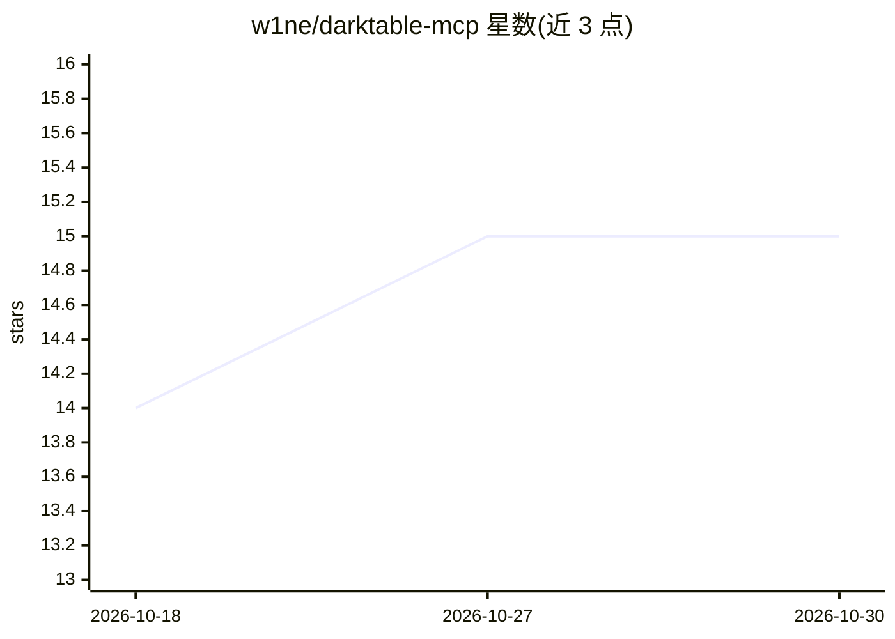

# w1ne/darktable-mcp

⭐ 15 · Python · MIT · 推送 2026-10-02 · [GitHub](https://github.com/w1ne/darktable-mcp) · [官网](https://shylenko.com/notes/darktable-mcp/) · 个人维护

**让 AI 客户端通过 MCP 操作 darktable 照片库的服务器**

面向使用 darktable 的摄影师：提供 MCP 服务器，让 Claude Desktop、Claude Code 等 MCP 客户端浏览、评分、打标签照片，经 gphoto2 从相机导入，用 darktable-cli 导出 JPEG/PNG/TIFF，并在（打补丁的）darktable 中读写暗房模块参数、蒙版与 LUT 对比。共暴露 54 个工具；不直接读写 library.db，库工具通过 Lua 插件与运行中的 darktable 通信。Linux 为主目标平台，macOS 不支持相机导入，Windows 不支持；暗房编辑功能需补丁版 darktable。

## 筛选速览

| 维度 | 判定 | 备注 |
|---|---|---|
| AI 角色 | `ai-ecosystem` | LLM/agent 周边工具 |
| 许可风险 | `permissive` | MIT |
| 部署形态 | `library` | 以包/库形式分发 |
| 模型依赖 | locked-api |  |
| 硬件要求 | — | 无带数字的原话,不猜 |
| 安装摩擦 | `low` | 无编译、无系统依赖或容器化 |
| 成熟度 | — | 结构信号不足 |

## 能力要点

- 54 个 MCP 工具，覆盖库管理、相机导入、导出、暗房编辑与蒙版
- 基于 gphoto2 的相机导入：按机身序列号分目录、按字节判重、不覆盖同名文件
- XMP 评分只改 rating 字节，保留 darktable 编辑历史
- 支持 stdio 与 Streamable HTTP 两种服务模式，可设 Bearer token

## 适用场景

- 让 AI 助手按清晰度和曝光为一批 RAW 照片评分并筛选
- 对话式地从相机导入照片、应用样式并批量导出
- 在暗房中让 AI 调整模块参数、管理蒙版并对比 LUT

## 场景标签

`图像视频处理` · 领域:感知与多模态

## 证据(README 行号)

> L3: An MCP server that lets Claude and other MCP clients work with your darktable library: browse and rate photos, impor
> L5: The AI runs in your MCP client (Claude Desktop, Claude Code, or any other client). This server only drives darktable
> L63: The server exposes 54 tools. The main groups:

## 星数曲线

2026-10-18 14 → 2026-10-30 15（+1）

---
*卡片 v1 · prompt 1.4 · 生成 2026-10-30 · 置信度 mid · 依据 README sha `f553e60faae7` · [字段定义](../../DATASET.md)*
