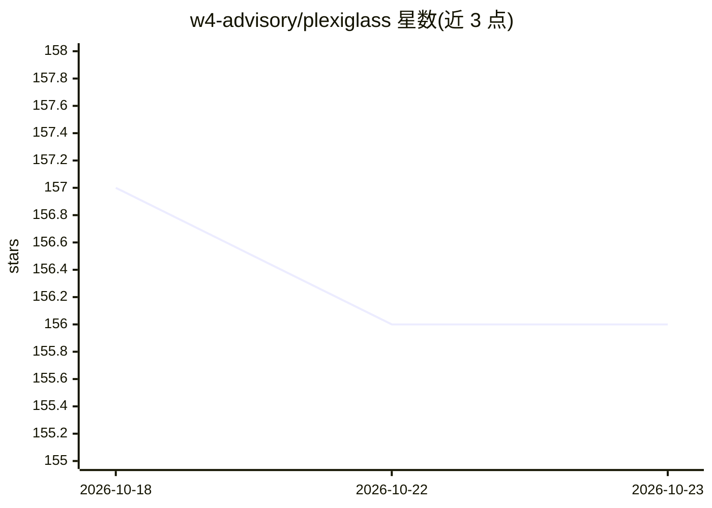

# w4-advisory/plexiglass

⭐ 156 · Python · Apache-2.0 · 推送 2026-02-04 · [GitHub](https://github.com/w4-advisory/plexiglass) · 组织维护

**面向开发者的 LLM 漏洞检测与防护工具包（CLI）**

Plexiglass 是一个用于检测和保护大语言模型（LLM）免受漏洞影响的工具包，以命令行界面提供。它支持两种模式：llm-chat 允许用户与 LLM 对话并测量预定义指标（毒性、PII 检测）；llm-scan 使用开源数据集对 LLM 运行基准测试，识别和评估安全、偏见与毒性等漏洞，数据来源包括 jailbreakchat.com 和 wiki_toxic 等对抗性提示集。当前版本为首个实验性发布 0.0.1，对抗提示模板、HTML 报告、独立 Python 模块等仍在开发路线图中未完成。

## 筛选速览

| 维度 | 判定 | 备注 |
|---|---|---|
| AI 角色 | `ai-ecosystem` | LLM/agent 周边工具 |
| 许可风险 | `permissive` | Apache-2.0 |
| 部署形态 | `library` | 以包/库形式分发 |
| 模型依赖 | — | README 未给出锁定关系 |
| 硬件要求 | — | 无带数字的原话,不猜 |
| 安装摩擦 | `low` | 无编译、无系统依赖或容器化 |
| 成熟度 | `idea` | |

## 能力要点

- llm-chat 模式：对话中测量毒性、PII 检测指标
- llm-scan 模式：基于开源数据集（jailbreakchat、wiki_toxic）做漏洞基准测试
- 支持对多个 LLM 进行安全、偏见与毒性基准测试

## 适用场景

- 测试 LLM 对提示注入、越狱等对抗攻击的表现
- 对多个 LLM 做安全、偏见与毒性基准评测
- 在对话中检测 LLM 输出的毒性与个人信息泄露

## 场景标签

 · 领域:AI 安全/LLM 评测

## 证据(README 行号)

> L10: Plexiglass is a toolkit for detecting and protecting against vulnerabilities in Large Language Models (LLMs).
> L12: It is a simple command line interface (CLI) tool which allows users to quickly test LLMs against adversarial attack
> L37: `llm-scan` runs benchmarks using open-source datasets to identify and assess various vulnerabilities in the LLM.

## 星数曲线

2026-10-18 157 → 2026-10-23 156（-1）

---
*卡片 v1 · prompt 1.4 · 生成 2026-10-22 · 置信度 high · 依据 README sha `e617100130d0` · [字段定义](../../DATASET.md)*
