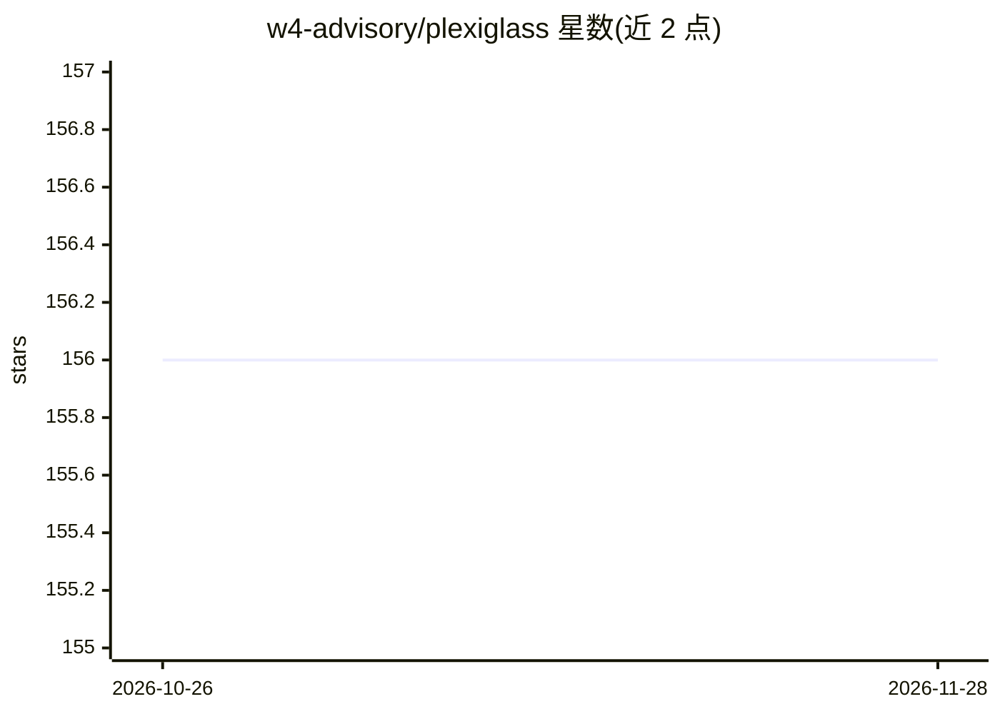

# w4-advisory/plexiglass

⭐ 156 · Python · Apache-2.0 · 推送 2026-11-04 · [GitHub](https://github.com/w4-advisory/plexiglass) · 个人维护

**对 LLM 应用端点运行安全断言测试的扫描工具包**

Plexiglass 对 JSON HTTP 应用端点和 Python 可调用对象执行显式安全断言：内置 prompt 注入、合成数据泄漏、良性对照三类测试套件，输出完整证据（manifest/results/report.html）并支持基线回归比较与 CI 门禁（退出码 0/1/2）。核心仅用 Python 标准库，要求 Python 3.10+，无模型下载与推理依赖；通过 chat-completion 兼容接口对接目标，不支持流式与非文本输出。无 LLM judge 与统计认证，样例仅为冒烟测试。

## 筛选速览

| 维度 | 判定 | 备注 |
|---|---|---|
| AI 角色 | `ai-ecosystem` | LLM/agent 周边工具 |
| 许可风险 | `permissive` | Apache-2.0 |
| 部署形态 | `library` | 以包/库形式分发 |
| 模型依赖 | — | README 未给出锁定关系 |
| 硬件要求 | — | 无带数字的原话,不猜 |
| 安装摩擦 | `low` | 无编译、无系统依赖或容器化 |
| 成熟度 | — | 结构信号不足 |

## 能力要点

- prompt_injection/data_leakage/benign 三类版本化测试套件（JSONL 格式）
- 基线回归比较：新引入失败即退出码 1，输出 comparison.json
- 每次运行生成完整证据目录（SHA-256 哈希、延迟、逐案例判定）
- HTTP 目标与 Python 可调用 SDK 两种接入方式，仅标准库实现

## 适用场景

- 在 CI 中对 LLM 应用端点做安全断言回归测试
- 验证系统提示中的机密指令（canary）不被泄漏
- 将安全扫描证据作为受限工件保存供审计

## 场景标签

`网络安全` `模型评测` · 领域:评测与运维

## 证据(README 行号)

> L3: Plexiglass evaluates explicit security assertions against JSON HTTP application endpoints and Python callables. The 
> L5: Requires Python 3.10+. The core uses only the Python standard library; no model downloads or inference libraries are
> L80: Run the scan command in CI using your test endpoint and committed case pack; preserve the evidence directory as a r

## 星数曲线

2026-10-26 156 → 2026-11-28 156（+0）

---
*卡片 v1 · prompt 1.4 · 生成 2026-11-27 · 置信度 high · 依据 README sha `7427fd37e3df` · [字段定义](../../DATASET.md)*
