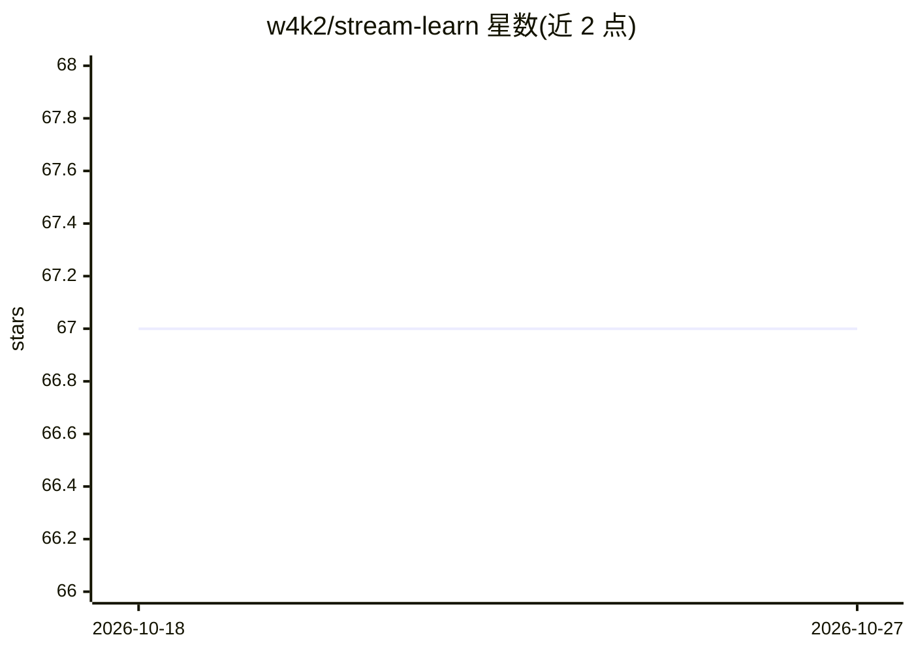

# w4k2/stream-learn

⭐ 67 · Python · GPL-3.0 · 推送 2026-05-05 · [GitHub](https://github.com/w4k2/stream-learn) · [官网](https://stream-learn.readthedocs.io) · 组织维护

**数据流挖掘 Python 库：用 scikit-learn 估计器做流式分类实验**

面向科研与开发者的数据流分析工具库：将数据集切分为连续 chunk 批处理，配合实现 partial_fit() 的 scikit-learn 估计器做流式分类。含五个子模块——支持多种概念漂移（含动态不平衡）的数据流生成器与 ARFF 解析器、Test-Then-Train/Prequential 评估器、流分类器、混合集成模型与流式评价指标。实验需声明分类器、数据流、指标与评估器四要素，结果存为三维 numpy 数组，提供 pip 与 conda 安装。

## 筛选速览

| 维度 | 判定 | 备注 |
|---|---|---|
| AI 角色 | `ai-native` | 本体是模型或模型工具 |
| 许可风险 | `viral` | GPL-3.0 |
| 部署形态 | `library` | 以包/库形式分发 |
| 模型依赖 | — | README 未给出锁定关系 |
| 硬件要求 | — | 无带数字的原话,不猜 |
| 安装摩擦 | `medium` | 含编译或系统依赖之一 |
| 成熟度 | — | 结构信号不足 |

## 能力要点

- StreamGenerator 支持多种概念漂移类型的合成数据流生成
- Test-Then-Train 与 Prequential 评估方法论实现
- 兼容 scikit-learn API 且实现 partial_fit() 的估计器均可接入
- ARFF 文件格式解析器

## 适用场景

- 在含概念漂移的数据流上评估增量学习分类器
- 生成合成数据流并按 chunk 批处理跑流式实验
- 比较多分类器在数据流上的指标表现并绘图

## 场景标签

`科研工具` · 领域:学习与行业

## 证据(README 行号)

> L8: The `stream-learn` module is a set of tools necessary for processing data streams using `scikit-learn` estimators. T
> L11: - `evaluators` - containing classes for running experiments on stream data in accordance with the Test-Then-Train a

## 星数曲线

2026-10-18 67 → 2026-10-27 67（+0）

---
*卡片 v1 · prompt 1.4 · 生成 2026-10-24 · 置信度 high · 依据 README sha `f2cb54739f0b` · [字段定义](../../DATASET.md)*
