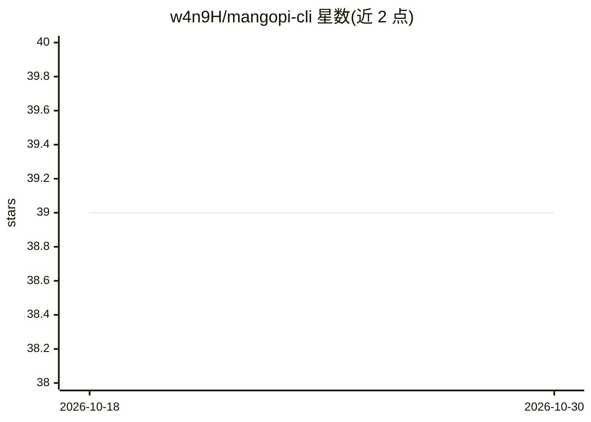

# w4n9H/mangopi-cli

⭐ 39 · Python · Apache-2.0 · 推送 2026-09-01 · [GitHub](https://github.com/w4n9H/mangopi-cli) · [官网](http://mangopi.chat/) · 个人维护 · 中文 README

**单文件零依赖的终端 AI 编码代理**

仅用 Python 标准库实现的本地优先自主编码代理，整个运行时为一个可修改的 Python 文件。内置读/写/编辑/搜索/grep/bash 等工具，支持 OpenAI 兼容 API（DeepSeek、MiniMax、自定义端点），具备上下文压缩、持久会话、SKILL.md 技能系统、17 个可选扩展（含 MCP 客户端、长期记忆、ACP agent 服务器）。通过预设目录实现工具白名单与系统提示词覆盖，提供 standard/minimal/codemode 三种运行模式。以 pip 安装或源码运行。

## 筛选速览

| 维度 | 判定 | 备注 |
|---|---|---|
| AI 角色 | `ai-native` | 本体是模型或模型工具 |
| 许可风险 | `permissive` | Apache-2.0 |
| 部署形态 | `library` | 以包/库形式分发 |
| 模型依赖 | locked-api |  |
| 硬件要求 | — | 无带数字的原话,不猜 |
| 安装摩擦 | `low` | 无编译、无系统依赖或容器化 |
| 成熟度 | — | 结构信号不足 |

## 能力要点

- 单文件架构，仅依赖 Python 标准库
- 支持 DeepSeek、MiniMax 及任意 OpenAI 兼容 API
- ACP v1 agent 服务器（--acp），可接入 Zed / JetBrains 等编辑器
- 17 个可选扩展：MCP 客户端、长期记忆、技能系统、剪贴板等

## 适用场景

- 在终端用自然语言驱动 AI 读写代码并执行命令
- 在 Zed / JetBrains 等编辑器中作为 ACP agent 使用
- 以 minimal/codemode 预设做模型能力基线测试

## 场景标签

`编码 Agent` · 领域:编码与开发

## 证据(README 行号)

> L15: > Single-file, zero-dependency AI coding assistant for the terminal.
> L17: Mangopi CLI is a local-first autonomous coding agent built with only the Python standard library.
> L74: * OpenAI-compatible API support

## 星数曲线

2026-10-18 39 → 2026-10-30 39（+0）

---
*卡片 v1 · prompt 1.4 · 生成 2026-10-25 · 置信度 high · 依据 README sha `6267da84d1ee` · [字段定义](../../DATASET.md)*
