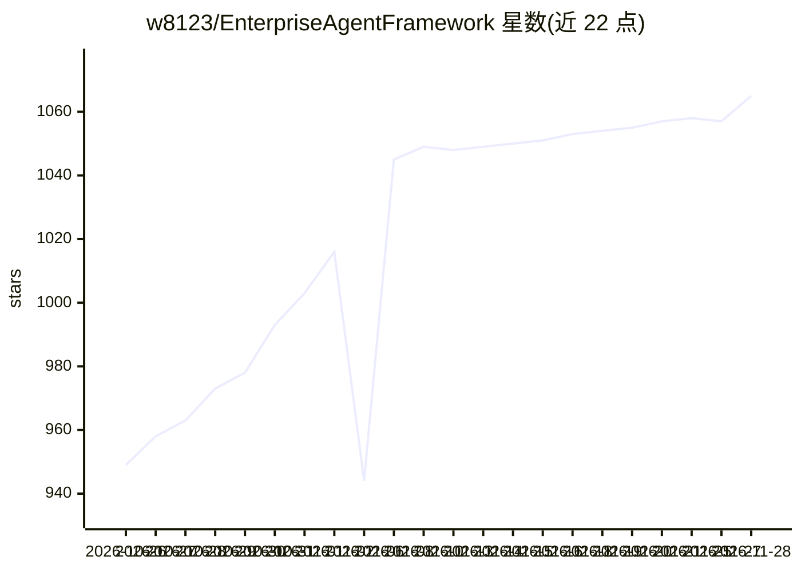

# w8123/EnterpriseAgentFramework

⭐ 1,065 · Java · MIT · 推送 2026-11-23 · [GitHub](https://github.com/w8123/EnterpriseAgentFramework) · 组织维护 · 中文 README

**企业业务系统智能化改造的智能体开发与运行平台**

面向已有 OA、ERP、CRM、eHR 等企业业务系统的智能体开发与运行平台：扫描页面与接口形成能力地图，推荐改造项并生成标准化工程任务交给 AI Coding 工具实施；业务能力以 Capability 形式注册，Agent 负责意图理解与 Workflow 选择，写入类操作需用户确认并保留 Trace 审计。后端为 Java/Spring Boot 五服务架构，配套 Vue 管理端，通过预构建镜像脚本或源码部署。

## 筛选速览

| 维度 | 判定 | 备注 |
|---|---|---|
| AI 角色 | `ai-ecosystem` | LLM/agent 周边工具 |
| 许可风险 | `permissive` | MIT |
| 部署形态 | `self-host` | docker 或自建部署 |
| 模型依赖 | — | README 未给出锁定关系 |
| 硬件要求 | — | 无带数字的原话,不猜 |
| 安装摩擦 | `low` | 无编译、无系统依赖或容器化 |
| 成熟度 | `idea` | |

## 能力要点

- 页面扫描、改造推荐、AI Coding 实施、验收与上线的完整改造流程
- Capability / Tool / Workflow 三类对象独立建模与治理
- READ 自动执行、WRITE 需确认、IRREVERSIBLE 默认拒绝的运行策略
- MCP Hub 与 A2A 互联中心对外发布 Tool 与远程 Agent

## 适用场景

- 让员工在原有 ERP 页面里用自然语言查库存、建客户
- 为缺少接口文档的存量系统做有代码依据的智能化盘点
- 在企业内对 Agent 运行做身份继承、工具白名单和审计追踪

## 场景标签

`Agent 框架` · 领域:Agent 开发

## 证据(README 行号)

> L7:  ReachAI · 面向企业业务系统的智能体开发与运行底座
> L75: 业务系统继续沿用原有页面、身份、权限、接口和业务规则；ReachAI 在平台侧统一提供智能体调度、工作流执行、模型接入、操作确认和运行追踪。完成基础接入后，后续新增 AI 场景可以持续复用同一套智能运行底座。
> L116: ReachAI 将任务范围、仓库上下文、修改约束、结构化输出和验收条件封装为标准化工程任务，交付给 Codex、Trae、Cursor 或 Claude Code 执行。AI Coding 工具持续回传进度、问题和交付证据；只有

## 星数曲线

2026-10-26 949 → 2026-11-28 1,065（+116）

---
*卡片 v1 · prompt 1.4 · 生成 2026-11-24 · 置信度 high · 依据 README sha `8e44b500c6f1` · [字段定义](../../DATASET.md)*
