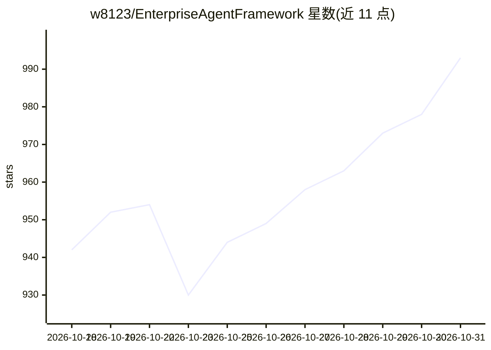

# w8123/EnterpriseAgentFramework

⭐ 993 · Java · MIT · 推送 2026-10-30 · [GitHub](https://github.com/w8123/EnterpriseAgentFramework) · 个人维护 · 中文 README

**面向 Java 企业系统的智能体开发与运行底座，改造存量 OA/ERP/CRM**

ReachAI 是一个企业智能体开发与运行平台：通过 SDK/扫描将 Java 业务系统的接口与页面接入，AI 主动扫描页面与能力、推荐改造项，生成标准化工程任务交由 Codex、Cursor、Claude Code 等 AI Coding 工具在真实仓库中实施，经验收后在原系统中嵌入对话助手，让员工用自然语言查数据、填表单、办业务。平台含五服务（模型网关、知识库、控制、运行时、能力目录），由 AgentScope Supervisor 调度 Workflow-as-Tool，以 Capability/Tool ACL/Guard 做权限治理，支持 MCP、A2A 开放协议。README 声明处于快速迭代阶段，部分节点为 BETA。

## 筛选速览

| 维度 | 判定 | 备注 |
|---|---|---|
| AI 角色 | `ai-ecosystem` | LLM/agent 周边工具 |
| 许可风险 | `permissive` | MIT |
| 部署形态 | `self-host` | docker 或自建部署 |
| 模型依赖 | — | README 未给出锁定关系 |
| 硬件要求 | — | 无带数字的原话,不猜 |
| 安装摩擦 | `low` | 无编译、无系统依赖或容器化 |
| 成熟度 | `idea` | |

## 能力要点

- 页面扫描 + 只读分析生成带代码证据的改造清单，交由 AI Coding 工具实施并验收
- Capability（业务资产）/Tool（模型协议）/Workflow（GraphSpec 编排）三者独立建模治理
- READ 自动执行、WRITE 需确认、IRREVERSIBLE 默认拒绝的风险分级运行策略与 Trace/RunOps 证据链
- 通过 Gateway、MCP、A2A 将已授权能力开放给 IDE、自动化工具与远程智能体

## 适用场景

- 在不替换原有 OA/ERP/CRM 页面与权限体系的前提下为业务系统加 AI 助手
- 用 AI Coding 工具按标准化任务完成存量系统改造并通过真实业务验收
- 企业内统一管理 Agent、Workflow、知识库与模型接入并追踪运行治理

## 场景标签

`Agent 框架` `模型网关` `AI 助手` · 领域:Agent 开发

## 证据(README 行号)

> L7:  ReachAI · 面向 Java 企业系统的企业智能体开发与运行底座
> L48: |1. 添加AI运行底座|识别项目技术栈，生成标准接入任务，由 AI Coding 集成后端连接、网关通信、页面助手、身份传递和安全校验组件|业务系统与 ReachAI 建立受控连接，获得能力注册、智能调度、页面交互与运行治理的统
> L261: |平台后端|Java 17、Spring Boot 3.4.5、Spring AI 1.0.0、Spring AI Alibaba 1.0.0.2|

## 星数曲线

2026-10-18 942 → 2026-10-31 993（+51）

---
*卡片 v1 · prompt 1.4 · 生成 2026-10-21 · 置信度 high · 依据 README sha `39b09501a1b4` · [字段定义](../../DATASET.md)*
