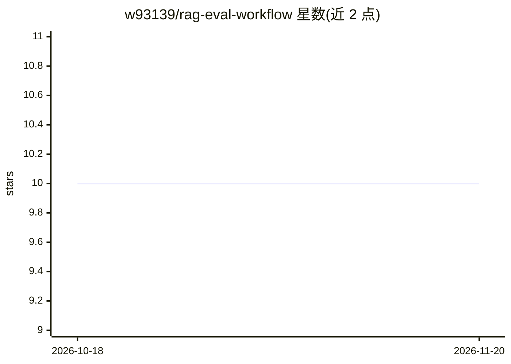

# w93139/rag-eval-workflow

⭐ 10 · Python · MIT · 推送 2026-09-07 · [GitHub](https://github.com/w93139/rag-eval-workflow) · 个人维护 · 中文 README

**给 Codex agent 用的 RAG 评测技能：金标集与回归门禁**

一个框架中立的 Codex Agent Skill，用于构建可复现的 RAG 评测流程：对源数据、OCR、分块、嵌入、索引、检索、生成各环节设置做版本化管理；创建并校验 golden 评测集；将检索与答案生成分开度量；与保存的基线对比并设回归门禁；按摄取、分块、检索、重排、生成、评测各层诊断失败。另附中文剧本与剧本杀知识库的专项检查（时间线、人物认知、线索、回合访问、剧透边界）。安装方式为 git clone 到 Codex 技能目录，配套 Python 脚本运行。明确不依赖 NVIDIA、RAGAS、特定向量库或托管 judge。

## 筛选速览

| 维度 | 判定 | 备注 |
|---|---|---|
| AI 角色 | `ai-ecosystem` | LLM/agent 周边工具 |
| 许可风险 | `permissive` | MIT |
| 部署形态 | `None` |  |
| 模型依赖 | — | README 未给出锁定关系 |
| 硬件要求 | — | 无带数字的原话,不猜 |
| 安装摩擦 | `low` | 无编译、无系统依赖或容器化 |
| 成熟度 | — | 结构信号不足 |

## 能力要点

- 检索与生成分开度量，回归门禁与基线对比
- 按摄取/分块/检索/重排/生成/评测分层诊断失败
- 剧本杀知识库专项检查：时间线、人物认知、线索、剧透边界
- 不绑定 NVIDIA/RAGAS/特定向量库/托管 judge

## 适用场景

- 为我的 RAG 项目建立可复现的评测金标集
- 迭代 RAG 配置时检测检索质量回归
- 评估剧本杀知识库问答在人物认知与剧透边界上的表现

## 场景标签

`模型评测` `RAG` · 领域:评测与运维

## 证据(README 行号)

> L3: A framework-neutral Codex Agent Skill for building reproducible RAG evaluations, with additional guidance for Chines
> L10: - compare candidates with a saved baseline and explicit regression gates;

## 星数曲线

2026-10-18 10 → 2026-11-20 10（+0）

---
*卡片 v1 · prompt 1.4 · 生成 2026-11-19 · 置信度 high · 依据 README sha `f519dc8134d5` · [字段定义](../../DATASET.md)*
