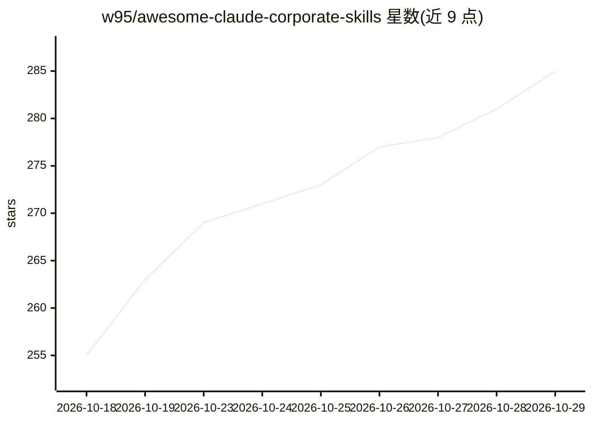

# w95/awesome-claude-corporate-skills

⭐ 285 · Python · MIT · 推送 2026-02-26 · [GitHub](https://github.com/w95/awesome-claude-corporate-skills) · 个人维护

**按企业职能组织的 166 个 Claude AI 技能策展清单**

面向 Claude 平台（Claude Code CLI、Claude Cowork Web、Claude API）的企业职能技能策展清单：收录 166 个 SKILL.md 格式的可复用指令集，按 14 个职能类别组织，覆盖高管战略、财务（42 个技能，含 DCF/LBO/三表模型）、HR、营销、销售、法务合规、运营、工程、产品、数据分析等。技能来源标注包括 Anthropic FSP/KWP、S&P Global、Apollo、Common Room 与社区。使用方式为 git clone 后在 Claude Code 中引用，或将 SKILL.md 直接用作系统提示。

## 筛选速览

| 维度 | 判定 | 备注 |
|---|---|---|
| AI 角色 | `ai-knowledge` | 知识聚合/清单类 |
| 许可风险 | `permissive` | MIT |
| 部署形态 | `None` |  |
| 模型依赖 | — | README 未给出锁定关系 |
| 硬件要求 | — | 无带数字的原话,不猜 |
| 安装摩擦 | `low` | 无编译、无系统依赖或容器化 |
| 成熟度 | — | 结构信号不足 |

## 能力要点

- 166 个技能按 14 个企业职能类别组织
- 兼容 Claude Code、Claude Cowork 与任何支持 SKILL.md 开放格式的工具
- 技能条目标注来源（Anthropic FSP/KWP、S&P Global、Apollo、Common Room、社区等）
- SKILL.md 可直接用作 API 调用的系统提示或参考材料

## 适用场景

- 为财务、法务、HR 等企业职能查找现成的 Claude 技能
- 通过 git clone 一次性获取全部技能用于 Claude Code
- 了解按职能划分的 Claude 企业技能生态覆盖范围

## 场景标签

`提示工程` `精选清单` · 领域:Agent 开发

## 证据(README 行号)

> L3:  The largest curated collection of Claude AI skills organized by corporate role
> L18:  166 production-ready skills across 14 categories &mdash; from executive strategy and investment banking to procure
> L20:  Built for Claude Code, Claude Cowork, and any tool supporting the open <code>SKILL.md</code> format.

## 星数曲线

2026-10-18 255 → 2026-10-29 285（+30）

---
*卡片 v1 · prompt 1.4 · 生成 2026-10-23 · 置信度 high · 依据 README sha `ab181ec66a09` · [字段定义](../../DATASET.md)*
