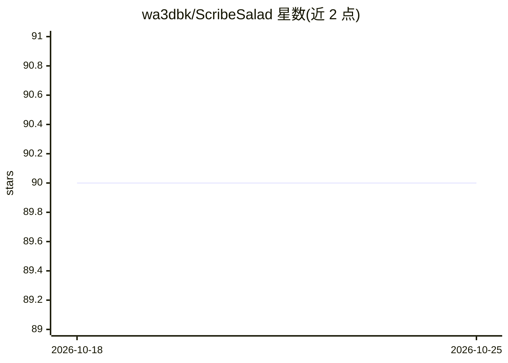

# wa3dbk/ScribeSalad

⭐ 90 · GPL-3.0 · 推送 2026-02-22 · [GitHub](https://github.com/wa3dbk/ScribeSalad) · 个人维护

**94 万+条 YouTube 视频转录文本开放数据集，多语言多主题**

开放数据项目，汇集超过 94 万条 YouTube 视频转录文本，来源覆盖 TED、耶鲁课程、MIT 讲座、Joe Rogan Experience、Jordan B. Peterson 演讲、Big Think 等播客与讲座频道，主题涉及社会政治、心理学、历史、科学与人工智能。部分转录来自视频上传者的字幕，其余由大词汇量连续语音识别系统自动生成（无背景噪音等干净条件下准确率约 90%）。每条转录以 YouTube 视频 ID 命名，提供 text、vtt、srt 三种格式；英语之外另有 10 种语言（阿拉伯语、法语、德语、西班牙语、俄语、土耳其语、葡萄牙语、意大利语、日语、韩语）。允许 fork、下载、分享与使用。TODO 中列出清理口语填充词、时间码重对齐、主题建模、说话人识别、搜索引擎与多语言翻译等计划。

## 筛选速览

| 维度 | 判定 | 备注 |
|---|---|---|
| AI 角色 | `ai-knowledge` | 知识聚合/清单类 |
| 许可风险 | `viral` | GPL-3.0 |
| 部署形态 | `None` |  |
| 模型依赖 | — | README 未给出锁定关系 |
| 硬件要求 | — | 无带数字的原话,不猜 |
| 安装摩擦 | `low` | 无编译、无系统依赖或容器化 |
| 成熟度 | — | 结构信号不足 |

## 能力要点

- 94 万+条 YouTube 视频转录文本，覆盖播客、大学讲座、科普频道
- 每条转录提供 text、vtt、srt 三种格式，以视频 ID 命名可回溯原视频
- 英语之外含 10 种语言的转录（ar/fr/de/es/ru/tr/pt/it/ja/ko）
- 开放数据许可，允许自由下载、分享与使用

## 适用场景

- 为 NLP 研究获取跨主题的口语转录语料
- 按频道或主题浏览和引用讲座、播客内容
- 基于转录 ID 回溯原视频制作字幕或引用片段

## 场景标签

 · 领域:NLP/开放数据集

## 证据(README 行号)

> L3: In absence of searchable transcripts, many interesting YouTube videos, podcasts, lectures and talks are hard to expl
> L28: The transcripts identified using the corresponding YouTube videos IDs and each one is available in three formats : 

## 星数曲线

2026-10-18 90 → 2026-10-25 90（+0）

---
*卡片 v1 · prompt 1.4 · 生成 2026-10-23 · 置信度 high · 依据 README sha `3f1137744eef` · [字段定义](../../DATASET.md)*
