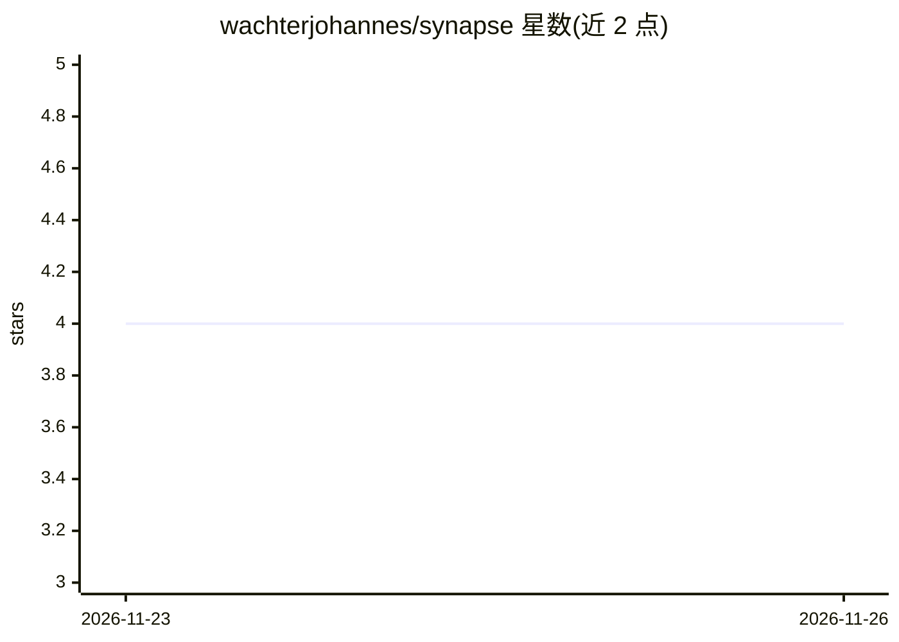

# wachterjohannes/synapse

⭐ 4 · PHP · MIT · 推送 2026-11-21 · [GitHub](https://github.com/wachterjohannes/synapse) · [官网](https://johanneswachter.dev/synapse/) · 个人维护

**用 Symfony AI 把 markdown 笔记变成可问答的 MCP 第二大脑**

Synapse 将一个 markdown 笔记目录做成第二大脑：capture 类 agent 把文本写入收件箱或整理为 Open Knowledge Format 结构化笔记，ask 类 agent 用 RAG 从笔记回答并标注来源文件，无法回答时返回 not found。笔记通过带外部授权服务器（Keycloak）的 MCP 服务器对外提供读写接口，支持 brain:read/brain:write 权限区分；app:federate 可向另一个 brain 提问并合并排序答案。提供浏览器界面（流式回答、语音输入输出、人工状态管理）。运行于 Symfony AI 1.0.0-BETA1 与 PHP MCP SDK，为 Symfony AI & MCP hackathon 作品，也是六部分教程系列的最终代码。

## 筛选速览

| 维度 | 判定 | 备注 |
|---|---|---|
| AI 角色 | `ai-native` | 本体是模型或模型工具 |
| 许可风险 | `permissive` | MIT |
| 部署形态 | `None` |  |
| 模型依赖 | locked-api |  |
| 硬件要求 | — | 无带数字的原话,不猜 |
| 安装摩擦 | `low` | 无编译、无系统依赖或容器化 |
| 成熟度 | `idea` | |

## 能力要点

- RAG 问答返回所引用的笔记文件，无法回答时输出 not found
- 以 MCP 服务器形式暴露笔记，含 read/write 令牌权限与工具只读限制
- app:federate 跨 brain 提问并用 reranker 合并排序答案
- 浏览器界面支持逐字流式回答与语音输入输出

## 适用场景

- 把个人 markdown 笔记变成可对话问答的知识库
- 通过 MCP 让其他工具读写共享笔记
- 多个第二大脑之间联邦提问并合并答案

## 场景标签

`RAG` `文档问答` · 领域:知识与检索

## 证据(README 行号)

> L5: Synapse is a folder of markdown notes that agents write to and read from, that other tools reach over MCP, and that 
> L9: - **Capture.** Hand a piece of text to an agent. A rough thought lands in `notes/inbox/`. A clear piece of knowledge
> L10: - **Ask.** A second agent answers from the notes with RAG and names the file it used. A question the notes cannot a

## 星数曲线

2026-11-23 4 → 2026-11-26 4（+0）

---
*卡片 v1 · prompt 1.4 · 生成 2026-11-23 · 置信度 high · 依据 README sha `eea9627bff5b` · [字段定义](../../DATASET.md)*
