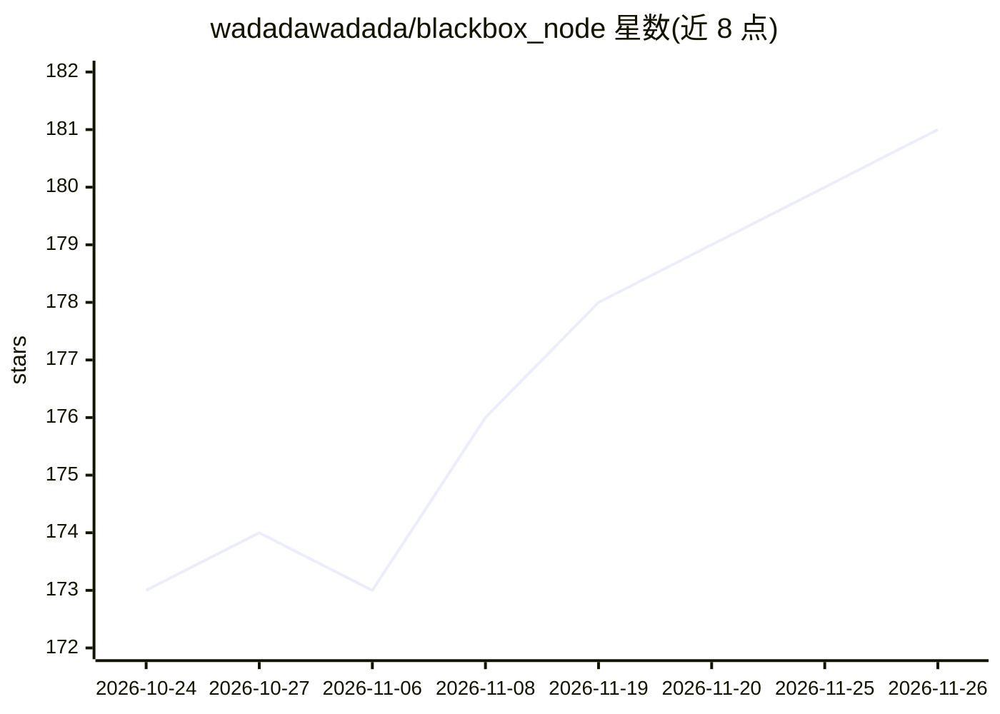

# wadadawadada/blackbox_node

⭐ 181 · JavaScript · NOASSERTION · 推送 2026-10-26 · [GitHub](https://github.com/wadadawadada/blackbox_node) · [官网](https://blackbox.host/) · 个人维护

**离线网格节点指挥所：本地 LLM+TAK 地图+链上支付**

自托管的 Web 应用，将 Meshtastic/MeshCore LoRa 网络接入一个离线优先的指挥界面：通过可切换桥接进程连接无线电，支持本地 llama.cpp 运行量化 GGUF 模型（无 API key、无云调用），网内其他节点可用 @bot/!ask 通过无线电查询 AI；同时提供 TAK/ATAK CoT 地图对象收发（含 fountain transfer 大载荷传输）、遥测记录、Bitcoin BIP-39 钱包与 Cashu ecash 离线支付。仅安装时需联网，运行期可完全断网；无线电功能需 USB 串口连接 Meshtastic 设备，无设备时仍可启动。

## 筛选速览

| 维度 | 判定 | 备注 |
|---|---|---|
| AI 角色 | `ai-enhanced` | 去掉 AI 部分产品仍成立 |
| 许可风险 | `none` | NOASSERTION |
| 部署形态 | `desktop` | 安装包/桌面程序 |
| 模型依赖 | local-ok | 支持本地模型 |
| 硬件要求 | — | 无带数字的原话,不猜 |
| 安装摩擦 | `medium` | 含编译或系统依赖之一 |
| 成熟度 | — | 结构信号不足 |

## 能力要点

- 本地 llama.cpp 运行 GGUF 模型，网内节点可经无线电 @bot/!ask 查询 AI
- TAK/ATAK CoT 地图对象收发，大载荷自动切换 fountain transfer
- 内置 Bitcoin HD 钱包与 Cashu ecash，支付令牌可作为纯文本经 mesh 传输
- mesh 斜杠命令（/summary /weather /battery 等）直接从遥测数据返回结构化结果

## 适用场景

- 灾害或断网环境下维持团队通信与态势感知
- 野外队伍用 Meshtastic 无线电共享 TAK 地图对象
- 无互联网地区经无线电收发 Cashu 小额支付
- 社区自建本地 AI 节点供邻居设备无线电提问

## 场景标签

`推理引擎` · 领域:训练与推理

## 证据(README 行号)

> L7: Blackbox Node is an offline-first command post for Meshtastic or MeshCore **LoRa** networks. It combines a fully loc
> L42: ### Local offline AI
> L86: ### Off-grid payments

## 星数曲线

2026-10-24 173 → 2026-11-26 181（+8）

---
*卡片 v1 · prompt 1.4 · 生成 2026-11-26 · 置信度 high · 依据 README sha `eb6770f14f05` · [字段定义](../../DATASET.md)*
