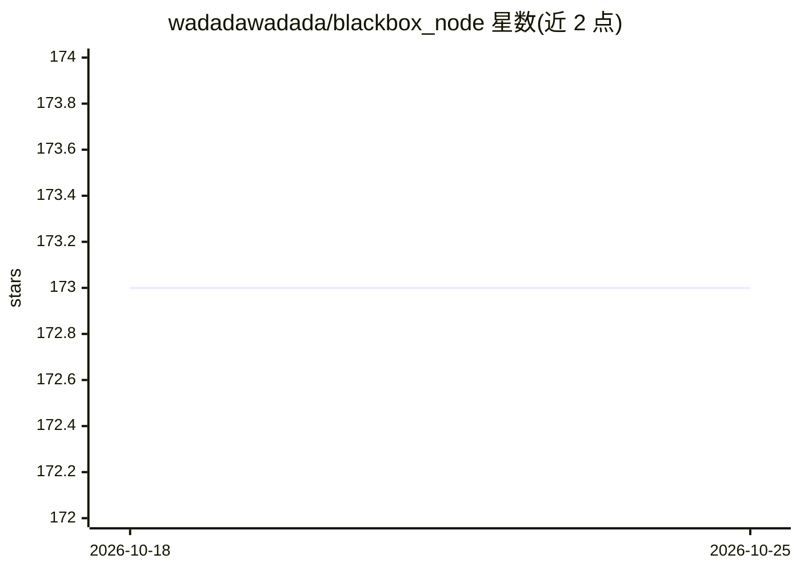

# wadadawadada/blackbox_node

⭐ 173 · JavaScript · NOASSERTION · 推送 2026-06-14 · [GitHub](https://github.com/wadadawadada/blackbox_node) · [官网](https://blackbox.host/) · 个人维护

**离线优先的 Meshtastic/LoRa 网状网指挥节点，集成本地 AI 与比特币支付**

自托管的 Web 应用：将笔记本电脑或主机变为 LoRa 网状网节点，通过 llama.cpp 运行本地量化 GGUF 模型，支持网内其他节点用 @bot/!ask 或斜杠命令经无线电查询 AI；收发 TAK/ATAK CoT 地图对象，记录消息、遥测与电池数据；内置 Bitcoin BIP-39 钱包与 Cashu ecash，可用文本 token 在网内转账。面向离网通信、灾害响应与外场行动等场景。运行需 Node.js 18+，无线电/TAK 功能另需 Python 3.11+ 与 USB 连接的 Meshtastic 设备；npm install 自动下载 llama.cpp 运行时与入门模型。

## 筛选速览

| 维度 | 判定 | 备注 |
|---|---|---|
| AI 角色 | `ai-enhanced` | 去掉 AI 部分产品仍成立 |
| 许可风险 | `none` | NOASSERTION |
| 部署形态 | `desktop` | 安装包/桌面程序 |
| 模型依赖 | local-ok | 支持本地模型 |
| 硬件要求 | — | 无带数字的原话,不猜 |
| 安装摩擦 | `medium` | 含编译或系统依赖之一 |
| 成熟度 | — | 结构信号不足 |

## 能力要点

- llama.cpp 运行本地量化 LLM，无 API key、无需联网
- Meshtastic 节点可通过无线电查询 AI 与斜杠命令
- TAK/ATAK CoT 地图对象经网状网收发，大负载自动切换喷泉传输
- Cashu ecash token 以文本消息经网内传递，支持外部钱包客户端远程付款

## 适用场景

- 停电或灾害时维持本地通信与态势感知
- 外场团队用 Meshtastic 加 TAK 式地图共享协同
- 社区网状网内运行本地 AI 助手与离线小额支付

## 场景标签

`AI 助手` · 领域:对话与助手

## 证据(README 行号)

> L7: Blackbox Node is an offline-first command post for Meshtastic and **LoRa** networks. It combines a fully local LLM, 
> L17: - Run a local offline AI assistant on your own machine with `llama.cpp`
> L42: Runs a quantized LLM entirely on your machine via `llama.cpp`. No API keys, no cloud calls, and no internet require

## 星数曲线

2026-10-18 173 → 2026-10-25 173（+0）

---
*卡片 v1 · prompt 1.4 · 生成 2026-10-22 · 置信度 high · 依据 README sha `5c771871c3d2` · [字段定义](../../DATASET.md)*
