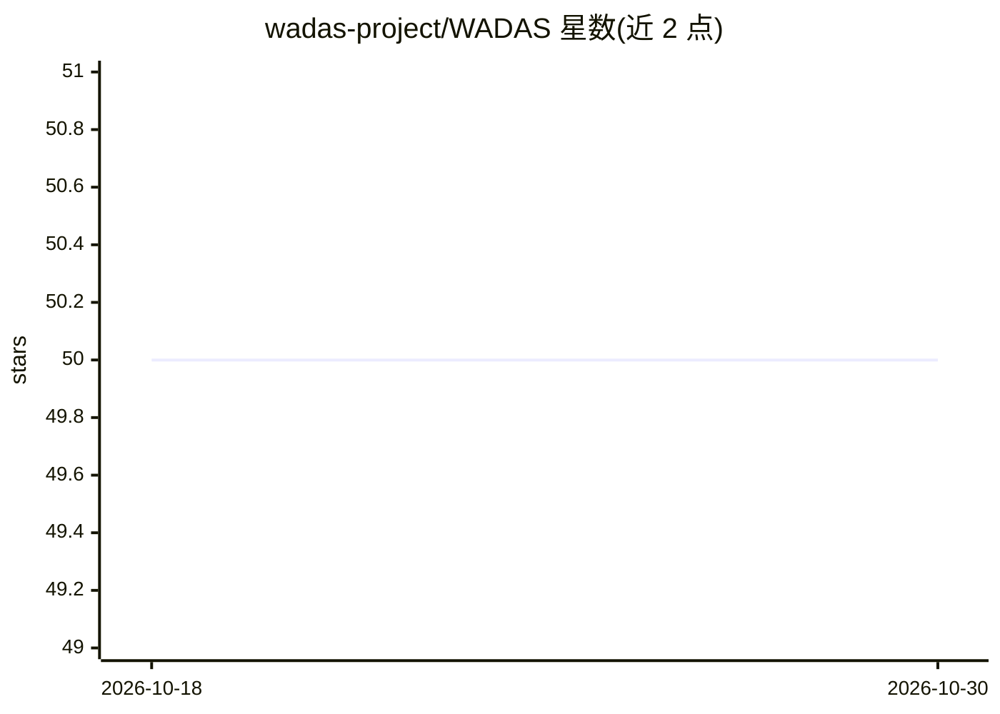

# wadas-project/WADAS

⭐ 50 · Python · GPL-3.0 · 推送 2026-10-07 · [GitHub](https://github.com/wadas-project/WADAS) · 组织维护

**野生动物 AI 检测与预警系统：防止动物在道路铁路事故中丧生**

由 Stefano Dell'Osa（Salviamo L'Orso 协会志愿者）与拉奎拉大学发起的非营利开源研究项目，面向危险区域（铁路隧道、公路交叉口）与居民点周边的野生动物检测与预警，目标包括识别马西坎棕熊并向保护机构推送监测通知。使用通过应用内申请获取的预编译模型（接受使用条款后免费分发），并定义了移动 App、地图集成、后端等最终产品形态的交互与实现基础。项目限定用于动物保护目的，禁止其他用途。README 未给出具体安装运行步骤，更多细节见项目 Wiki 与 wadas.it。

## 筛选速览

| 维度 | 判定 | 备注 |
|---|---|---|
| AI 角色 | `ai-native` | 本体是模型或模型工具 |
| 许可风险 | `viral` | GPL-3.0 |
| 部署形态 | `None` |  |
| 模型依赖 | — | README 未给出锁定关系 |
| 硬件要求 | — | 无带数字的原话,不猜 |
| 安装摩擦 | `low` | 无编译、无系统依赖或容器化 |
| 成熟度 | — | 结构信号不足 |

## 能力要点

- 面向铁路隧道、公路交叉口等危险区域的野生动物 AI 检测与预警
- 目标物种包含马西坎棕熊的识别与专项监测通知
- 预编译模型通过应用内申请、接受条款后免费提供
- 非营利开源，限定动物保护用途（违规将依法追责）

## 适用场景

- 在铁路隧道或公路动物穿越点部署检测预警
- 村庄、农场周边的野生动物活动监测
- 向保护机构推送马西坎棕熊等物种的监测通知

## 场景标签

`目标检测` · 领域:感知与多模态

## 证据(README 行号)

> L2: *Wild Animals Detection and Alert System* (WADAS) is a project kicked off by Stefano Dell'Osa, volunteer for Salviam
> L17: WADAS uses pre-compiled models available by submitting an access request through WADAS application. They are freely

## 星数曲线

2026-10-18 50 → 2026-10-30 50（+0）

---
*卡片 v1 · prompt 1.4 · 生成 2026-10-24 · 置信度 mid · 依据 README sha `9d98081ba268` · [字段定义](../../DATASET.md)*
