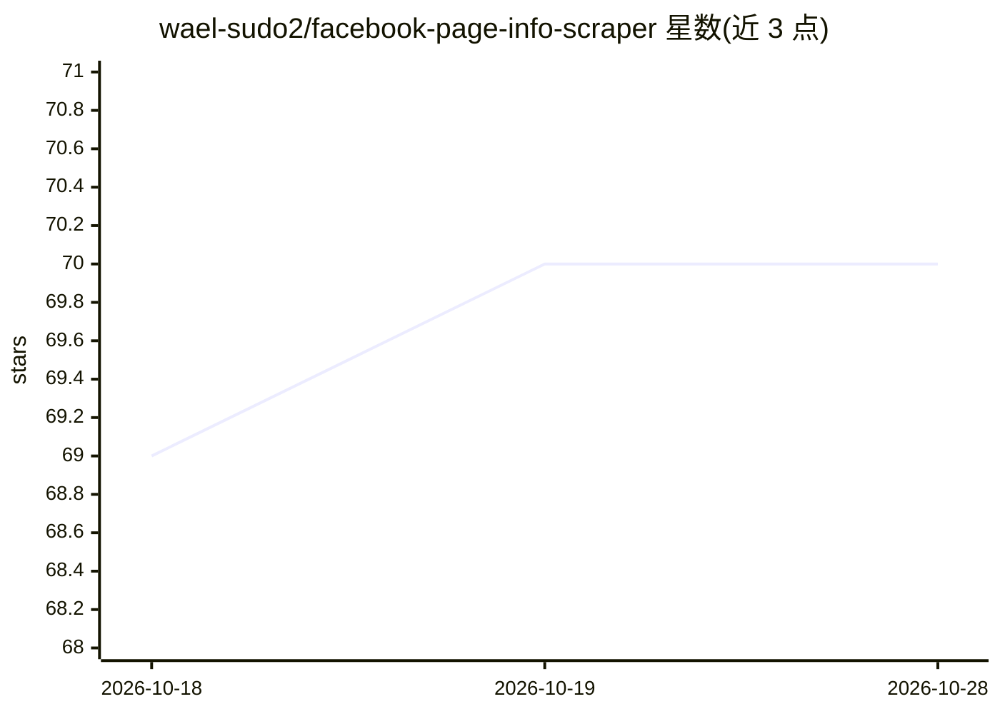

# wael-sudo2/facebook-page-info-scraper

⭐ 70 · Python · MIT · 推送 2026-10-12 · [GitHub](https://github.com/wael-sudo2/facebook-page-info-scraper) · 个人维护

**免登录免 API key 的 Facebook 公共主页信息爬取库**

Python 库，输入 Facebook 主页 URL，返回名称、类别、邮箱、电话、地址、评分等公共字段。提供双引擎：requests 的 HTTP 引擎（约 1.4 秒/页）与 Playwright 浏览器引擎（约 3 秒/页，需 JavaScript），两者均读取页面 payload 而非 CSS。附带联系 enrichment 功能：访问主页所列网站找回缺失邮箱，按规则打分输出置信度，bot 挑战站点用浏览器 TLS 指纹重试；其中 role/personal 标注为 opt-in，需 OpenAI 或 DeepSeek API key，无 key 时其余功能不受影响。支持代理、多线程与 CLI。

## 筛选速览

| 维度 | 判定 | 备注 |
|---|---|---|
| AI 角色 | `ai-enhanced` | 去掉 AI 部分产品仍成立 |
| 许可风险 | `permissive` | MIT |
| 部署形态 | `library` | 以包/库形式分发 |
| 模型依赖 | — | README 未给出锁定关系 |
| 硬件要求 | — | 无带数字的原话,不猜 |
| 安装摩擦 | `low` | 无编译、无系统依赖或容器化 |
| 成熟度 | — | 结构信号不足 |

## 能力要点

- HTTP 与 Playwright 浏览器双引擎，返回相同字段
- 联系 enrichment 从所列网站找回缺失邮箱并给出评分与理由
- AI 标注 role/personal 为 opt-in，需 API key，失败时回退为 unknown
- bot 挑战站点自动用浏览器 TLS 指纹重试

## 适用场景

- 批量抓取 Facebook 公共主页的基本信息
- 补全抓取结果中缺失的邮箱联系方式
- 区分公司邮箱与个人邮箱以满足 GDPR 合规需要

## 场景标签

`网页抓取` · 领域:效率与自动化

## 证据(README 行号)

> L3: **Public Facebook page info as a Python dict — fast, no login, no API key.**
> L73: DeepSeek) and `curl_cffi`. The AI step is opt-in and needs only an API key —
> L217: **Nothing extra to install** — set an API key and switch it on:

## 星数曲线

2026-10-18 69 → 2026-10-28 70（+1）

---
*卡片 v1 · prompt 1.4 · 生成 2026-10-24 · 置信度 high · 依据 README sha `83dc97968989` · [字段定义](../../DATASET.md)*
