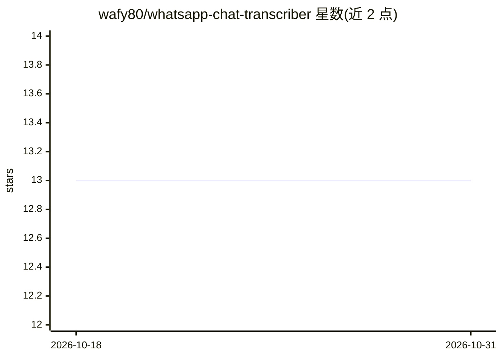

# wafy80/whatsapp-chat-transcriber

⭐ 13 · Python · MIT · 推送 2026-04-16 · [GitHub](https://github.com/wafy80/whatsapp-chat-transcriber) · 个人维护

**把 WhatsApp 聊天导出转成 PDF 并用 Whisper 转录语音**

读取 WhatsApp 导出的 chat.zip，解析消息历史，嵌入图片与媒体引用，生成可自定义版式（WhatsApp 风格/极简/纯文本三种 HTML 模板）的 PDF；语音消息使用 OpenAI Whisper 本地转录并内嵌于 PDF。支持 100+ 转录语言、6 种界面语言、批量处理、转写缓存（重新生成秒级）与隐私选项（排除图片）。提供 Web 上传界面（局域网或 cloudflared/ngrok 隧道）与 PWA 分享直达。需 Python 3.8+ 与 ffmpeg，通过 convert.sh 包装脚本或手动 venv 运行。

## 筛选速览

| 维度 | 判定 | 备注 |
|---|---|---|
| AI 角色 | `ai-native` | 本体是模型或模型工具 |
| 许可风险 | `permissive` | MIT |
| 部署形态 | `library` | 以包/库形式分发 |
| 模型依赖 | — | README 未给出锁定关系 |
| 硬件要求 | — | 无带数字的原话,不猜 |
| 安装摩擦 | `medium` | 含编译或系统依赖之一 |
| 成熟度 | — | 结构信号不足 |

## 能力要点

- OpenAI Whisper 本地转录语音消息并内嵌 PDF
- 转写缓存，重新生成最快 3 秒
- 三种 HTML 模板，颜色字体边距可配置
- Web 上传界面 + PWA 分享直达，手机端直接上传导出包

## 适用场景

- 把 WhatsApp 聊天记录连同语音转录归档成 PDF
- 批量转换多个聊天导出文件
- 在手机上通过分享菜单直接上传并下载 PDF

## 场景标签

`语音识别` · 领域:感知与多模态

## 证据(README 行号)

> L10: Convert WhatsApp chat exports to beautifully formatted PDFs with automatic audio transcription using AI.
> L30: - 🎙️ **AI-powered audio transcription** using OpenAI Whisper
> L154: - Python 3.8+

## 星数曲线

2026-10-18 13 → 2026-10-31 13（+0）

---
*卡片 v1 · prompt 1.4 · 生成 2026-10-31 · 置信度 high · 依据 README sha `edf08c46f20b` · [字段定义](../../DATASET.md)*
