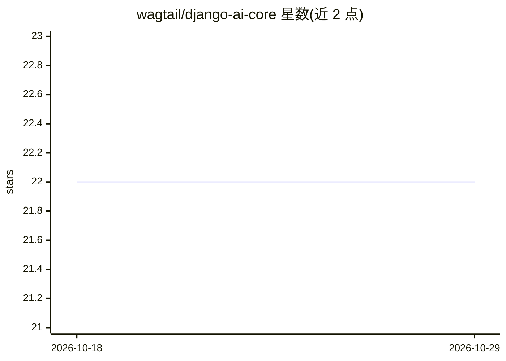

# wagtail/django-ai-core

⭐ 22 · Python · BSD-3-Clause · 推送 2026-08-04 · [GitHub](https://github.com/wagtail/django-ai-core) · [官网](https://django-ai-core.readthedocs.io/) · 组织维护

**在 Django 站点中集成 AI 工具的开发者库（早期）**

面向 Django 开发者的 AI 功能集成包，定位为在 Django 项目中与 LLM 交互提供核心功能，并可选用模块构建 AI 应用。README 目前主要由 TODO 清单构成，规划中的内容包括 LLM 请求日志、异步/流式支持、Agent 限流与流式响应、Index 后端测试与文档、带聊天界面的 Chat/RAG 模块，以及 MCP 函数注册表。仓库由 Wagtail 组织维护，处于开发早期，尚未在 README 中给出安装与运行说明。

## 筛选速览

| 维度 | 判定 | 备注 |
|---|---|---|
| AI 角色 | `ai-ecosystem` | LLM/agent 周边工具 |
| 许可风险 | `permissive` | BSD-3-Clause |
| 部署形态 | `None` |  |
| 模型依赖 | — | README 未给出锁定关系 |
| 硬件要求 | — | 无带数字的原话,不猜 |
| 安装摩擦 | `low` | 无编译、无系统依赖或容器化 |
| 成熟度 | `idea` | |

## 能力要点

- 为 Django 项目提供与 LLM 交互的核心功能
- 规划可选模块：Agent、Index、Chat/RAG、MCP 注册表
- 由 Wagtail 组织维护

## 适用场景

- 在 Django 站点中接入 LLM 交互能力
- 关注并参与 Django AI 基础组件的早期共建
- 基于其规划模块构建带聊天界面的 RAG 应用

## 场景标签

 · 领域:Web 开发/LLM 集成

## 证据(README 行号)

> L3: **Developer-focused package for implementing AI tooling into Django sites.**
> L5: Django AI Core provides core functionality for interacting with LLMs in your Django project, as well as optional mod

## 星数曲线

2026-10-18 22 → 2026-10-29 22（+0）

---
*卡片 v1 · prompt 1.4 · 生成 2026-10-27 · 置信度 mid · 依据 README sha `6b9cf9544b05` · [字段定义](../../DATASET.md)*
