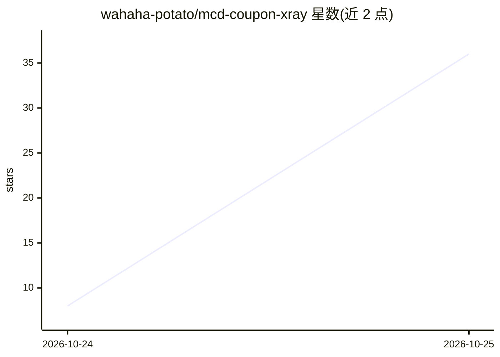

# wahaha-potato/mcd-coupon-xray

⭐ 123 · Python · MIT · 推送 2026-10-23 · [GitHub](https://github.com/wahaha-potato/mcd-coupon-xray) · 个人维护 · 中文 README

**麦当劳优惠券核销校验 Skill：逐店验哪张券真能用**

面向麦当劳消费者的 MCP Skill（SKILL.md + 自检脚本）：先一键领取麦麦省全部可领券，再逐家门店调用 query-store-coupons 与 calculate-price 校验哪张券在该店能核销、券后实付多少，输出门店对比表、跨店可用性矩阵与一句可执行的省钱结论。README 记录了五个实测事实（如按 couponId 而非券名去重、卡包为空则按店查必为空）。需自备麦当劳 MCP Token，在 WorkBuddy 等支持 MCP 的客户端中使用；结论仅对调用当时有效。

## 筛选速览

| 维度 | 判定 | 备注 |
|---|---|---|
| AI 角色 | `ai-native` | 本体是模型或模型工具 |
| 许可风险 | `permissive` | MIT |
| 部署形态 | `None` |  |
| 模型依赖 | — | README 未给出锁定关系 |
| 硬件要求 | — | 无带数字的原话,不猜 |
| 安装摩擦 | `low` | 无编译、无系统依赖或容器化 |
| 成熟度 | — | 结构信号不足 |

## 能力要点

- 一键领取后逐门店校验券的真实可核销性与券后实付
- 区分 query-my-coupons 与 query-store-coupons 两接口语义，先领券再查店
- 以 couponId 为唯一标识去重，避免同券名不同活动被合并
- 提供自检脚本与测试（scripts/xray.py --selftest、pytest）

## 适用场景

- 搞清卡包里一堆券今天在楼下哪家店真的能用
- 在多家门店间比较券后实付选最省的一家
- 查同一张券在哪些门店可核销

## 场景标签

`数据分析` · 领域:效率与自动化

## 证据(README 行号)

> L58: 在 WorkBuddy（或任何支持 MCP 的客户端）里配好麦当劳 MCP，然后直接说：
> L68: Skill 会走完整条链：
> L117: 把 `SKILL.md` 放到 `~/.workbuddy/skills/mcd-coupon-xray/` 下，重启会话即可。

## 星数曲线

2026-10-24 8 → 2026-10-25 36（+28）

---
*卡片 v1 · prompt 1.4 · 生成 2026-10-25 · 置信度 high · 依据 README sha `62672a6a6229` · [字段定义](../../DATASET.md)*
