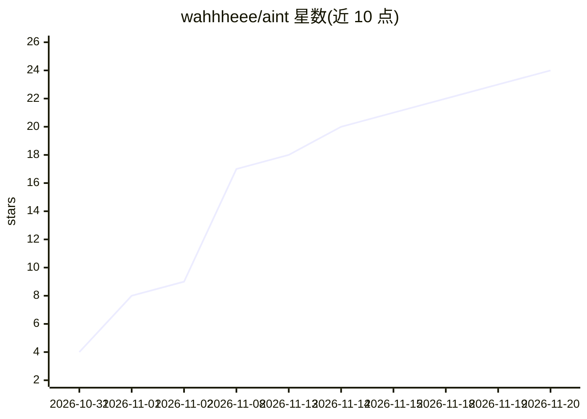

# wahhheee/aint

⭐ 24 · Go · Apache-2.0 · 推送 2026-11-18 · [GitHub](https://github.com/wahhheee/aint) · 个人维护 · 中文 README

**本地运行的 AI 互动小说运行时，导入作品连接模型阅读游玩**

AINT（AINT Is Not Tavern）是在本机运行的 AI 互动小说运行时：玩家导入由 YAML、Markdown、Liquid 模板与素材组成的作品目录，配置模型 API（已支持 Anthropic Messages、OpenAI Responses、Gemini 及 Google Vertex AI），在浏览器中阅读、选择行动或自由输入。运行时提供记忆整理、状态维护、分支重写、音频、用量与费用统计、调试检查器与访问密码。程序用 Go 后端与 React 前端，发布为单个可执行文件，数据存本机；当前为开发预览，仅验证 Windows/amd64 实际运行。

## 筛选速览

| 维度 | 判定 | 备注 |
|---|---|---|
| AI 角色 | `ai-native` | 本体是模型或模型工具 |
| 许可风险 | `permissive` | Apache-2.0 |
| 部署形态 | `desktop` | 安装包/桌面程序 |
| 模型依赖 | — | README 未给出锁定关系 |
| 硬件要求 | — | 无带数字的原话,不猜 |
| 安装摩擦 | `low` | 无编译、无系统依赖或容器化 |
| 成熟度 | `idea` | |

## 能力要点

- 支持 Anthropic Messages、OpenAI Responses、Gemini 及 Vertex AI 渠道
- 上下文达到预算时自动整理记忆并保留近期回合
- 作品由 YAML/Markdown/Liquid 模板组成，支持状态、命令、面板与主题
- 单可执行文件发布，作品、设置与存档保存在本机

## 适用场景

- 在本地阅读并游玩 AI 互动小说作品
- 作者编写含人物设定、状态与分支的作品并导入
- 局域网访问与他人共享阅读体验

## 场景标签

`聊天机器人` · 领域:对话与助手

## 证据(README 行号)

> L7: AINT 是在本机运行的 AI 互动小说运行时。玩家导入作品，配置模型 API，在浏览器中阅读、选择行动或自由输入。程序使用 Go 后端与 React 前端，发布为单个可执行文件，作品、设置和存档保存在本机。
> L9: 作品是一个包含 YAML、Markdown、Liquid 模板和素材的目录。作者可以编写执笔指令、人物与世界设定、多个开场、状态、命令、面板和主题。模型通过工具查阅资料、维护记忆与状态、生成正文和选项；上下文达到预算时，运行时整理记
> L11: **当前为开发预览。** 已支持 Anthropic Messages、OpenAI Responses、Gemini，以及 Google Vertex AI 渠道，作品导入与更新、开发目录、分支、重写、音频、用量与费用、调试检查

## 星数曲线

2026-10-31 4 → 2026-11-20 24（+20）

---
*卡片 v1 · prompt 1.4 · 生成 2026-11-18 · 置信度 high · 依据 README sha `87900bd75c45` · [字段定义](../../DATASET.md)*
