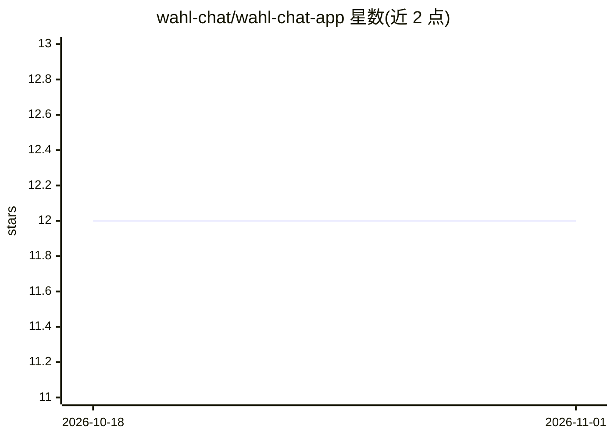

# wahl-chat/wahl-chat-app

⭐ 12 · Python · NOASSERTION · 推送 2026-10-31 · [GitHub](https://github.com/wahl-chat/wahl-chat-app) · [官网](https://wahl.chat) · 组织维护

**德国选举政治问答聊天机器人平台（RAG，带来源佐证）**

wahl.chat 的平台源码：面向德国联邦/州/地方选举的政治信息聊天机器人，让用户以对话方式了解政党立场，回答附带可溯源的出处。代码库包含 Next.js 前端、FastAPI+SSE+LangChain 的 Python RAG 后端、含 Qdrant 集合配置的语料摄取层、共享包与 Firebase 配置。本地开发需 Node 22+、bun、uv、Docker 与 Firebase CLI，通过 Makefile 启动，仅需填入 LLM API key 即可运行；许可证为 PolyForm Noncommercial（非商业）。

## 筛选速览

| 维度 | 判定 | 备注 |
|---|---|---|
| AI 角色 | `ai-native` | 本体是模型或模型工具 |
| 许可风险 | `none` | NOASSERTION |
| 部署形态 | `self-host` | docker 或自建部署 |
| 模型依赖 | — | README 未给出锁定关系 |
| 硬件要求 | — | 无带数字的原话,不猜 |
| 安装摩擦 | `low` | 无编译、无系统依赖或容器化 |
| 成熟度 | — | 结构信号不足 |

## 能力要点

- RAG 后端（FastAPI + SSE + LangChain）生成带来源的政党立场回答
- 含 Qdrant 向量库摄取管线与集合初始化
- Makefile 驱动的完整本地开发流程（Qdrant + Firestore 模拟器，无需生产凭据）
- 提供 PledgeTracker 承诺数据摄取与 E2E 冒烟测试

## 适用场景

- 德国选民就政党立场提问并获得有出处的回答
- 研究者本地部署并复现该政治问答平台
- 了解面向政治教育的 RAG 应用工程结构

## 场景标签

`聊天机器人` `RAG` · 领域:对话与助手

## 证据(README 行号)

> L3: A grounded political information chatbot for German elections — federal, state, and local.
> L11: The aim of wahl.chat is to enable users to engage in a contemporary way with the positions of political parties and
> L18: |`ai-backend/`|Python AI/RAG backend (FastAPI + SSE + LangChain)|README|

## 星数曲线

2026-10-18 12 → 2026-11-01 12（+0）

---
*卡片 v1 · prompt 1.4 · 生成 2026-10-31 · 置信度 mid · 依据 README sha `d162b35a74c7` · [字段定义](../../DATASET.md)*
