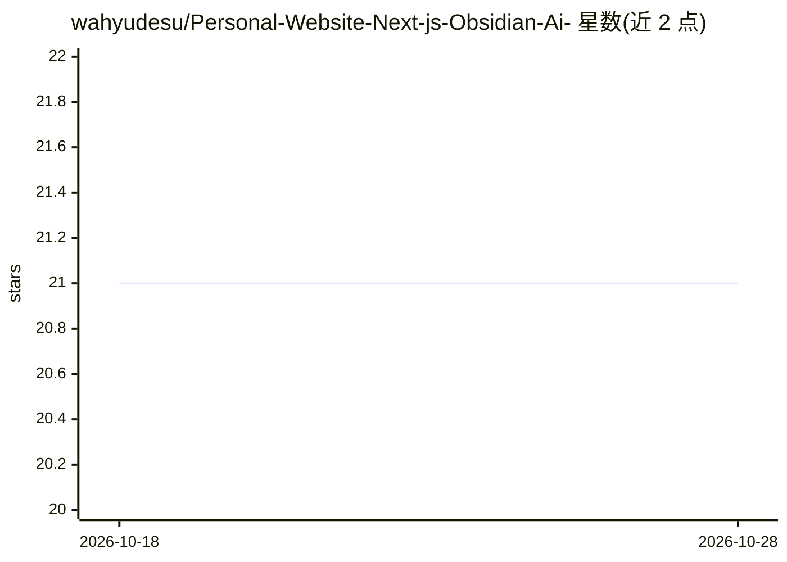

# wahyudesu/Personal-Website-Next-js-Obsidian-Ai-

⭐ 21 · TypeScript · CC0-1.0 · 推送 2026-01-02 · [GitHub](https://github.com/wahyudesu/Personal-Website-Next-js-Obsidian-Ai-) · [官网](https://wahyuikbal.com) · 个人维护

**个人网站模板：Next.js 15 博客与作品集，附开发中 AI 功能**

基于 Next.js 15 App Router 的个人网站，包含 TypeScript、TailwindCSS、Shadcn/ui 组件库、Framer Motion 动画与 Contentlayer 管理的 Markdown 博客。功能含浅/深色主题切换、RSS 与 Sitemap 等 SEO 支持、响应式设计、PostHog 与 Vercel Analytics 统计，以及通过 FormSpree 的表单邮件服务。AI 部分使用 Vercel AI SDK，README 标注为 on progress。项目基于 timlrx 的 tailwind-nextjs-starter-blog 改建。

## 筛选速览

| 维度 | 判定 | 备注 |
|---|---|---|
| AI 角色 | `ai-enhanced` | 去掉 AI 部分产品仍成立 |
| 许可风险 | `viral` | CC0-1.0 |
| 部署形态 | `None` |  |
| 模型依赖 | — | README 未给出锁定关系 |
| 硬件要求 | — | 无带数字的原话,不猜 |
| 安装摩擦 | `low` | 无编译、无系统依赖或容器化 |
| 成熟度 | `idea` | |

## 能力要点

- Next.js 15 App Router + TypeScript + TailwindCSS 技术栈
- Contentlayer 管理 Markdown 博客，RSS/Sitemap/robots.txt SEO 支持
- AI SDK 集成（README 标注 on progress）
- PostHog 与 Vercel Analytics 统计、FormSpree 表单邮件

## 适用场景

- 搭建带博客的个人作品集网站
- 学习 Next.js 15 个人网站工程结构
- 在个人网站上添加 AI 功能作为附加特性

## 场景标签

 · 领域:Web/个人网站

## 证据(README 行号)

> L9: - 🚀 Next.js 15 (App Router) - Modern web framework
> L15: - 🤖 AI SDK - ai sdk (on progress)

## 星数曲线

2026-10-18 21 → 2026-10-28 21（+0）

---
*卡片 v1 · prompt 1.4 · 生成 2026-10-28 · 置信度 mid · 依据 README sha `a2e7d6ae3ecd` · [字段定义](../../DATASET.md)*
