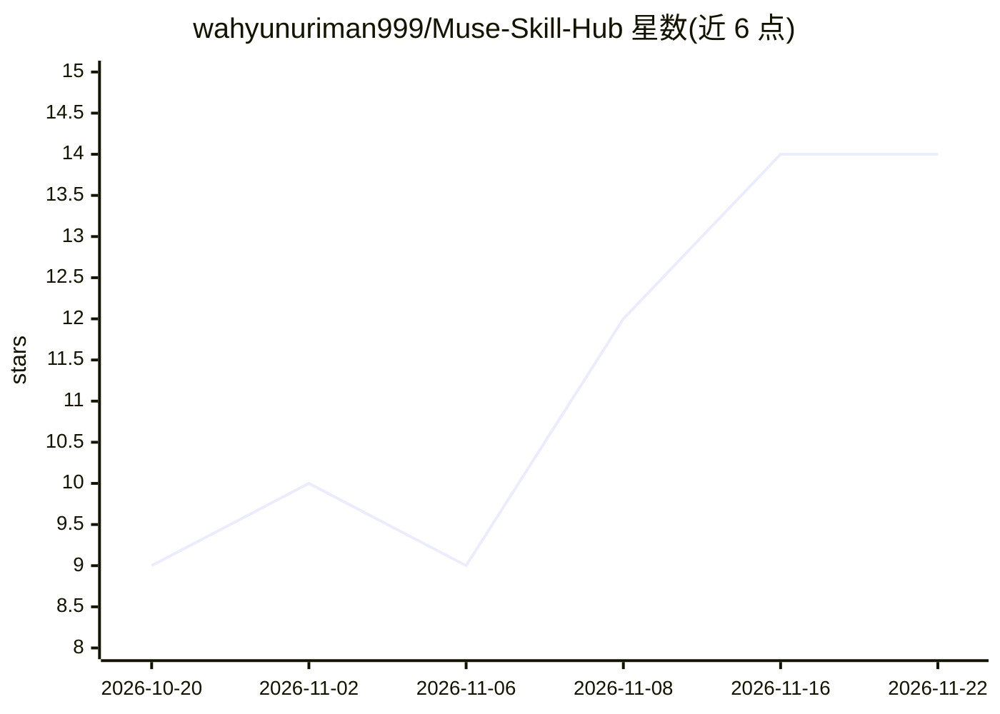

# wahyunuriman999/Muse-Skill-Hub

⭐ 14 · Python · AGPL-3.0 · 推送 2026-10-09 · [GitHub](https://github.com/wahyunuriman999/Muse-Skill-Hub) · [官网](https://github.com/wahyunuriman999/Muse-Skill-Hub) · 个人维护

**面向 AI agent 的 LLM 无关能力运行时：97 技能封装为 MCP 工具**

为 AI agent 提供能力运行时：将 97 个技能（62 个第三方 API 驱动如 GitHub/Slack/Stripe/Notion，32 个本地实现，3 个诚实存根）以 222 个带完整 JSON Schema 的 MCP 工具形式暴露，支持动态能力发现。内置审批引擎（风险分级、approval_id 单次使用 10 分钟有效）、策略引擎、审计日志（哈希链防篡改检测）、幂等键与加密凭据存储（secret 不经过 LLM）。技能定义用通用 SKILL.md 格式，任何 LLM 可加载。声明为本地单用户可信运行时，多租户隔离与分布式精确一次不在范围内。由个人创建，技能目录源自对 Muse（Meta 个人 AI agent）能力的编目。

## 筛选速览

| 维度 | 判定 | 备注 |
|---|---|---|
| AI 角色 | `ai-ecosystem` | LLM/agent 周边工具 |
| 许可风险 | `viral` | AGPL-3.0 |
| 部署形态 | `library` | 以包/库形式分发 |
| 模型依赖 | — | README 未给出锁定关系 |
| 硬件要求 | — | 无带数字的原话,不猜 |
| 安装摩擦 | `medium` | 含编译或系统依赖之一 |
| 成熟度 | — | 结构信号不足 |

## 能力要点

- 97 技能 / 96 可执行驱动 / 222 个带 JSON Schema 的 MCP 工具
- 风险分级审批引擎：敏感操作需绑定 skill/action/params 的单次 approval_id
- 审计日志带哈希链，CLI 可检测篡改
- 通用 SKILL.md 技能格式，任何 LLM 可加载

## 适用场景

- 为 Claude/GPT/Gemini 等 agent 接入 GitHub、Slack、Google 系列等 API 能力
- 给 agent 的写操作加审批与审计管控
- 参考 Muse 的能力清单设计自己的 agent 技能

## 场景标签

`Agent 框架` · 领域:Agent 开发

## 证据(README 行号)

> L7: > An open, LLM-agnostic capability runtime for AI agents. Define capabilities once. Discover them dynamically. Execu
> L17: This repo is no longer just a catalog — it ships a **real MCP server**
> L31: - **MCP tools** (per-action, fully typed) + `skillhub_search_capabilities` for dynamic capability discovery (counts

## 星数曲线

2026-10-20 9 → 2026-11-22 14（+5）

---
*卡片 v1 · prompt 1.4 · 生成 2026-11-18 · 置信度 high · 依据 README sha `72a161167938` · [字段定义](../../DATASET.md)*
