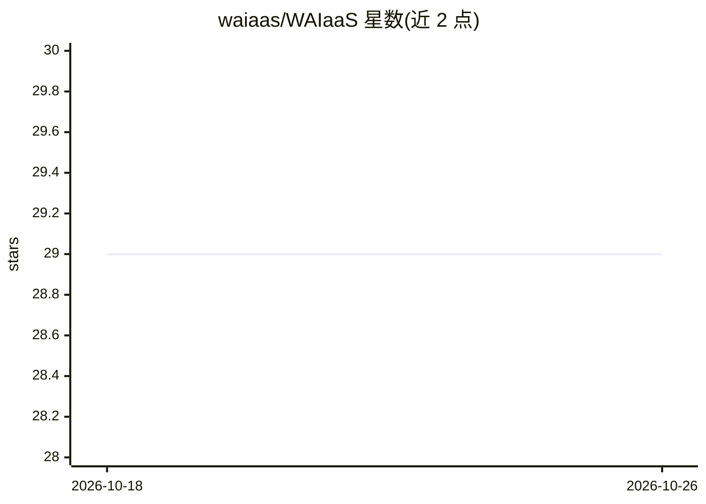

# waiaas/WAIaaS

⭐ 29 · TypeScript · MIT · 推送 2026-08-20 · [GitHub](https://github.com/waiaas/WAIaaS) · [官网](https://waiaas.ai/) · 个人维护

**自托管的 AI agent 链上钱包守护进程：代付交易、策略管控**

本地运行的 Wallet 守护进程，位于 AI agent 与区块链之间：agent 可即时执行小额链上交易，大额交易需资金所有者批准，密钥不离开本机。提供三级认证（daemon 操作者/资金所有者/agent 会话）、按 USD 金额自动分级的 4 层策略引擎与 12 种策略类型，另有 Kill Switch、AutoStop、审计日志与 4 通道通知。支持 Solana 与 EVM 共 13 个网络，通过 MCP server、技能文件、SDK、CLI、REST 与 Admin UI 等多种接口接入 agent。

## 筛选速览

| 维度 | 判定 | 备注 |
|---|---|---|
| AI 角色 | `ai-ecosystem` | LLM/agent 周边工具 |
| 许可风险 | `permissive` | MIT |
| 部署形态 | `self-host` | docker 或自建部署 |
| 模型依赖 | — | README 未给出锁定关系 |
| 硬件要求 | — | 无带数字的原话,不猜 |
| 安装摩擦 | `low` | 无编译、无系统依赖或容器化 |
| 成熟度 | — | 结构信号不足 |

## 能力要点

- 三级认证与按 USD 金额分级的 4 层策略引擎（12 种策略类型）
- Solana（SPL/Token-2022）与 EVM（ERC-20）共 13 个网络
- MCP server、.skill.md 技能文件、TypeScript/Python SDK、CLI、Admin UI 多接口接入
- agent 可通过 --auto-provision 全自主完成安装配置

## 适用场景

- 让 AI agent 在限额内自动执行链上转账与 DeFi 操作
- 为 agent 钱包设置支出上限、代币白名单与大额审批流程
- 通过 Admin UI 或 Telegram Bot 管理多链钱包与会话

## 场景标签

 · 领域:区块链/AI agent 基础设施

## 证据(README 行号)

> L11: A self-hosted wallet daemon that lets AI agents perform on-chain transactions securely -- while the owner keeps ful
> L47: - **@waiaas/mcp** — Model Context Protocol server for AI agents
> L92: The daemon runs as an MCP server. Your agent calls wallet tools directly -- send tokens, check balances, manage pol

## 星数曲线

2026-10-18 29 → 2026-10-26 29（+0）

---
*卡片 v1 · prompt 1.4 · 生成 2026-10-26 · 置信度 high · 依据 README sha `34f55a645734` · [字段定义](../../DATASET.md)*
