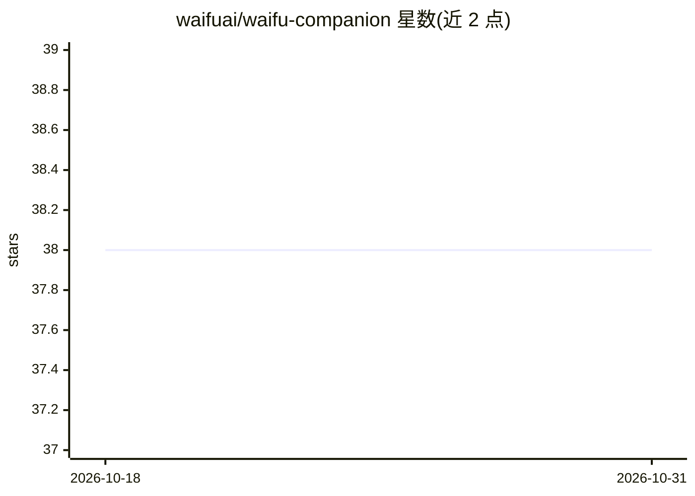

# waifuai/waifu-companion

⭐ 38 · JavaScript · MIT-0 · 推送 2026-10-28 · [GitHub](https://github.com/waifuai/waifu-companion) · [官网](https://waifuai.com) · 组织维护

**浏览器端 Live2D 桌面 AI 伴侣：语音聊天与长期记忆**

纯客户端 Web 应用，用 Live2D Cubism 模型渲染 50+ 内置角色（支持自定义加载与多角色同屏），配合 LLM 对话形成桌面伴侣体验。LLM 接入 OpenRouter 与 Groq，支持流式输出、自动模型回退及离线本地启发式引擎；对话记忆带可配置深度与自动摘要。语音侧提供 Kokoro 本地 ONNX TTS（WebGPU/WASM）、TikTok TTS、浏览器合成回退及 Web Speech API 语音输入。通过 git clone 后以任意静态服务器运行，MIT-0 许可。

## 筛选速览

| 维度 | 判定 | 备注 |
|---|---|---|
| AI 角色 | `ai-native` | 本体是模型或模型工具 |
| 许可风险 | `permissive` | MIT-0 |
| 部署形态 | `library` | 以包/库形式分发 |
| 模型依赖 | locked-api |  |
| 硬件要求 | — | 无带数字的原话,不猜 |
| 安装摩擦 | `low` | 无编译、无系统依赖或容器化 |
| 成熟度 | — | 结构信号不足 |

## 能力要点

- OpenRouter/Groq 双供应商接入，含自动回退与离线本地引擎
- Live2D 50+ 内置模型、自定义加载与多角色同屏
- Kokoro 本地 ONNX TTS、TikTok TTS 与 Web Speech STT
- 对话记忆深度可配置，自动摘要保留长会话上下文

## 适用场景

- 在浏览器里养一个可自定义性格的 Live2D 角色伴侣
- 用语音与角色对话并获得口型同步的语音回复
- 离线时也能与本地回退引擎继续基础交互

## 场景标签

`聊天机器人` `语音 Agent` · 领域:对话与助手

## 证据(README 行号)

> L7: **Waifu Companion** is a fully customizable, browser-based intelligent assistant that brings your favorite character
> L12: - **OpenRouter Support**: Use custom LLM models via OpenRouter API with up to 2 fallback models

## 星数曲线

2026-10-18 38 → 2026-10-31 38（+0）

---
*卡片 v1 · prompt 1.4 · 生成 2026-10-25 · 置信度 mid · 依据 README sha `d9a8bb8a3c14` · [字段定义](../../DATASET.md)*
