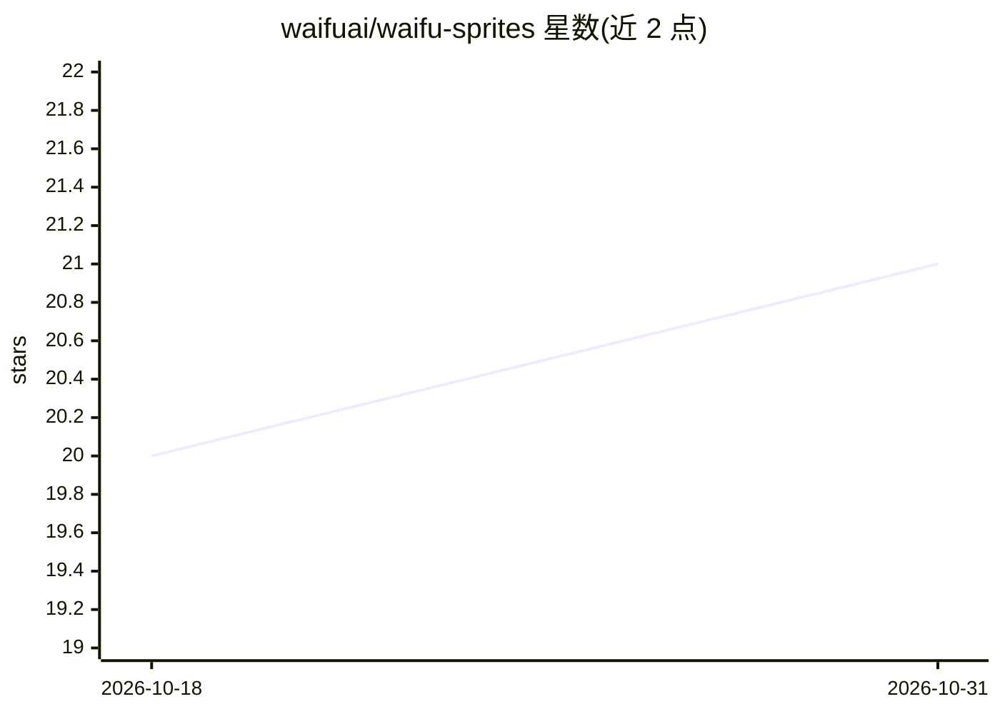

# waifuai/waifu-sprites

⭐ 21 · Python · MIT-0 · 推送 2026-05-14 · [GitHub](https://github.com/waifuai/waifu-sprites) · 个人维护

**hermes-agent 的桌宠插件：随 agent 状态换播情绪视频**

运行于 hermes-agent 仪表盘内的插件：通过 agent hooks 写入 state.json，Python/FastAPI 后端读取状态并按映射表（idle/speaking/thinking/typing 等）切换 videos/ 目录下对应 MP4 片段，前端以 React（Hermes SDK）实现悬浮可拖拽覆盖层、侧边栏组件与设置面板。可从 agent 回复中检测情绪并切换匹配视频。安装方式为克隆到 ~/.hermes/plugins 后触发插件重扫，前置条件为已安装 hermes-agent 与 Python 3.8+。

## 筛选速览

| 维度 | 判定 | 备注 |
|---|---|---|
| AI 角色 | `ai-ecosystem` | LLM/agent 周边工具 |
| 许可风险 | `permissive` | MIT-0 |
| 部署形态 | `None` |  |
| 模型依赖 | — | README 未给出锁定关系 |
| 硬件要求 | — | 无带数字的原话,不猜 |
| 安装摩擦 | `low` | 无编译、无系统依赖或容器化 |
| 成熟度 | — | 结构信号不足 |

## 能力要点

- agent 状态到视频文件的实时映射（idle/thinking/typing 等）
- 从 agent 回复中检测情绪并切换对应视频
- 悬浮可拖拽覆盖层、侧边栏组件与设置面板
- 后端纯 Python（FastAPI），前端基于 Hermes Plugin SDK

## 适用场景

- 给 hermes-agent 仪表盘加一个随状态变化的桌面伴侣形象
- 通过视频反馈直观感知 agent 当前在思考、输入或搜索
- 为 AI 助手界面增加情感化呈现

## 场景标签

 · 领域:AI agent 界面/陪伴插件

## 证据(README 行号)

> L3: **Video-based AI companion for hermes-agent.**
> L5: A dashboard plugin that displays a video-based waifu companion that reacts to your agent's state in real-time — idle
> L23: The plugin runs inside the hermes dashboard. Agent hooks update `state.json`, the backend reads it and serves the c

## 星数曲线

2026-10-18 20 → 2026-10-31 21（+1）

---
*卡片 v1 · prompt 1.4 · 生成 2026-10-28 · 置信度 high · 依据 README sha `d31127f353ff` · [字段定义](../../DATASET.md)*
