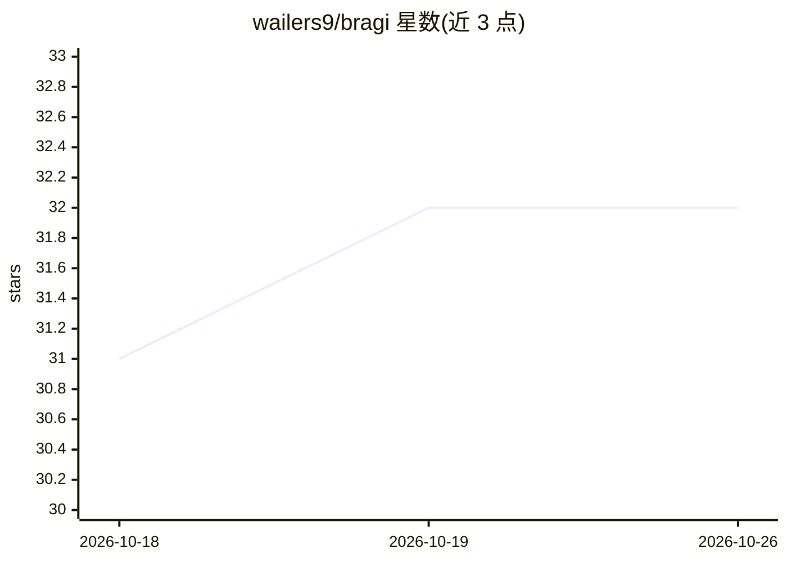

# wailers9/bragi

⭐ 32 · Python · 推送 2026-05-17 · [GitHub](https://github.com/wailers9/bragi) · 个人维护 · 中文 README

**面向幻想创作者的 AI 架空世界与长篇故事生成引擎**

从一句设定出发生成世界概览、历史脉络、地理结构、角色网络与剧情的互动故事引擎。核心机制是用数字路径（如 1,2,3）组织时间树与空间树，当前节点保留完整内容、附近节点保留摘要、按需扩写，以控制上下文用量并让 agent 携带世界记忆持续创作。提供 CLI 与本地黑白 Web 可视化界面，内置无需外部 API 的 Demo Agent，也支持 OpenAI 与 DeepSeek JSON Agent，世界数据按目录持久化保存并记录 token 用量。Python 3.10+，源码安装运行。

## 筛选速览

| 维度 | 判定 | 备注 |
|---|---|---|
| AI 角色 | `ai-native` | 本体是模型或模型工具 |
| 许可风险 | `none` | — |
| 部署形态 | `library` | 以包/库形式分发 |
| 模型依赖 | locked-api |  |
| 硬件要求 | — | 无带数字的原话,不猜 |
| 安装摩擦 | `low` | 无编译、无系统依赖或容器化 |
| 成熟度 | — | 结构信号不足 |

## 能力要点

- 时间与空间双树结构，数字路径定位并按需扩展节点
- 自动生成角色网络并在剧情推进时更新角色状态
- 内置本地 Demo Agent，不配置 API 可跑通完整流程
- 支持 OpenAI 与 DeepSeek JSON Agent，世界数据目录化持久保存

## 适用场景

- 生成架空大陆、魔法王朝等世界观设定并持续扩写
- 长篇连载或跑团世界观辅助创作
- 互动小说原型与 AI Agent 叙事系统实验

## 场景标签

`AI 写作` · 领域:内容生成

## 证据(README 行号)

> L3: 现有能够生成小说的 Agent 常常受限于短期记忆，容易出现角色情节设定冲突的问题。Bragi 通过标准化的时空规范和人物事件记录解决了这一问题，让agent每次都能带着世界记忆继续创作。
> L5: Bragi 是一个面向幻想创作者的 AI 架空世界与互动故事引擎。给它一句世界设定，它会像搭建一座会呼吸的宇宙一样，生成历史、地理、角色、事件和剧情，并在后续创作中持续记住这些设定。
> L15: - **持续写故事**：根据世界观、当前地点、历史事件、角色状态和用户方向继续生成剧情。

## 星数曲线

2026-10-18 31 → 2026-10-26 32（+1）

---
*卡片 v1 · prompt 1.4 · 生成 2026-10-25 · 置信度 mid · 依据 README sha `56e5bfad4f69` · [字段定义](../../DATASET.md)*
