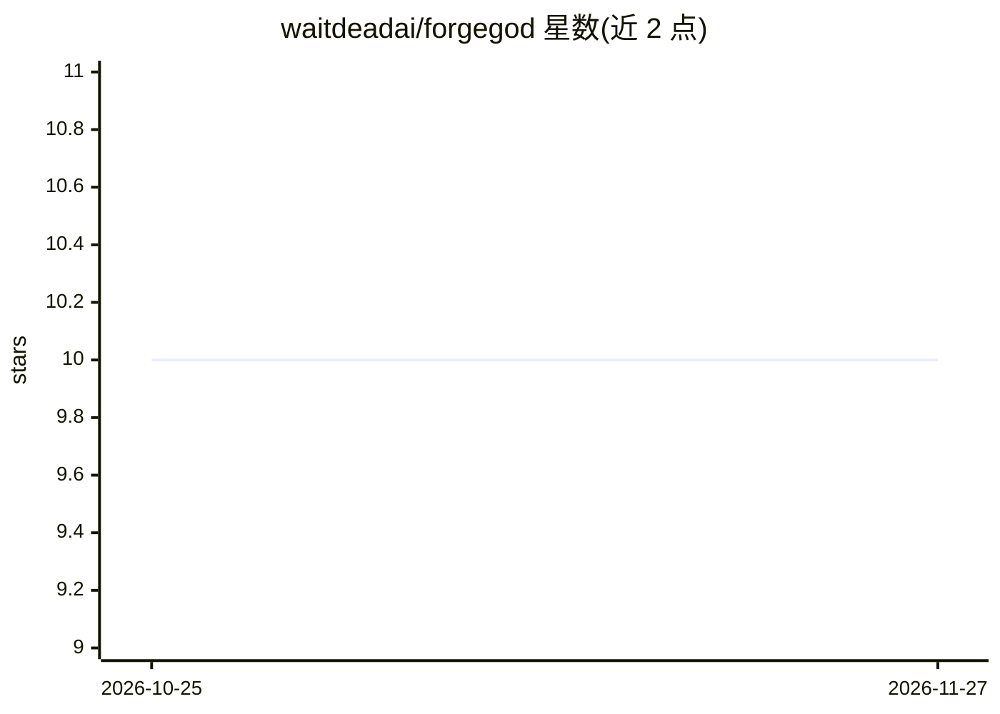

# waitdeadai/forgegod

⭐ 10 · Python · Apache-2.0 · 推送 2026-04-19 · [GitHub](https://github.com/waitdeadai/forgegod) · [官网](https://forgegod.com) · 个人维护

**多模型路由的自主编码 Agent，支持本地 $0 运行**

面向开发者与非开发者的 CLI 编码 Agent：编排 OpenAI、Anthropic、Gemini、Ollama、DeepSeek 等 9 个 provider 家族，按角色（planner/coder/reviewer 等）路由到不同模型。核心机制包括从 PRD 出发的 24/7 Ralph Loop、5 层认知记忆（情节/语义/程序/图/错误方案）、3 次递进模型升级的 Reflexion 生成、SICA 自改策略，以及按支出自动切换的预算模式。提供 conversational、run、hive（多进程隔离 worktree）、audit 等子命令，运行时记忆存于 SQLite，Obsidian 为可选投影层。

## 筛选速览

| 维度 | 判定 | 备注 |
|---|---|---|
| AI 角色 | `ai-native` | 本体是模型或模型工具 |
| 许可风险 | `permissive` | Apache-2.0 |
| 部署形态 | `library` | 以包/库形式分发 |
| 模型依赖 | local-ok | 支持本地模型 |
| 硬件要求 | — | 无带数字的原话,不猜 |
| 安装摩擦 | `low` | 无编译、无系统依赖或容器化 |
| 成熟度 | — | 结构信号不足 |

## 能力要点

- 9 个 provider 家族多模型自动路由，支持 adversarial 与 single-model 两种 profile
- Ralph Loop：从 PRD 出发的 24/7 自主编码，进度保存在 git 而非 LLM 上下文
- 5 层认知记忆，自动衰减、巩固与强化
- Ollama 本地 $0 模式与预算模式（normal→throttle→local-only→halt）

## 适用场景

- 用自然语言描述需求让 Agent 自动生成代码
- 从 PRD 持续自主推进多个开发故事
- 无 API key 场景下用本地 Ollama 模型零成本运行
- 通过 hive 协调器在隔离 worktree 中并行处理任务

## 场景标签

`编码 Agent` `Agent 记忆` · 领域:Agent 开发

## 证据(README 行号)

> L10:  The coding agent that runs 24/7, learns from its mistakes, and costs $0 when you want it to.
> L21: ForgeGod orchestrates multiple LLMs (OpenAI, Anthropic, Google Gemini, Ollama, OpenRouter, DeepSeek, Kimi via Moons

## 星数曲线

2026-10-25 10 → 2026-11-27 10（+0）

---
*卡片 v1 · prompt 1.4 · 生成 2026-11-19 · 置信度 mid · 依据 README sha `082012f002f3` · [字段定义](../../DATASET.md)*
