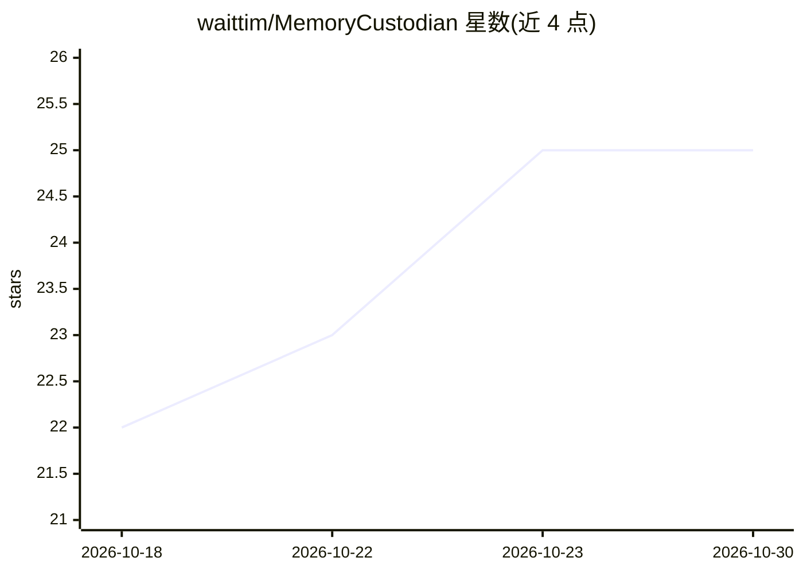

# waittim/MemoryCustodian

⭐ 25 · Python · MIT · 推送 2026-09-27 · [GitHub](https://github.com/waittim/MemoryCustodian) · 个人维护

**给编码 agent 的项目记忆工具：仓库内 Markdown 持久记忆**

面向 Codex、Claude Code、Gemini Agents 等编码代理的项目记忆管理工具：将决策、约束、被否决方案等持久上下文以纯 Markdown 存放在仓库 docs/memory/ 目录，通过 manifest 规则按任务类别路由有界上下文包，不依赖 RAG 或向量库。提供 Python 标准库实现的 CLI（零第三方运行时依赖），记录需证据支持并使用稳定 ID，遗忘操作采用预览优先与作用域限定，多文件写入带锁与事务日志。限制：遗忘不重写 Git 历史，Protocol 0.8 为 pre-1.0 版本。

## 筛选速览

| 维度 | 判定 | 备注 |
|---|---|---|
| AI 角色 | `ai-ecosystem` | LLM/agent 周边工具 |
| 许可风险 | `permissive` | MIT |
| 部署形态 | `library` | 以包/库形式分发 |
| 模型依赖 | — | README 未给出锁定关系 |
| 硬件要求 | — | 无带数字的原话,不猜 |
| 安装摩擦 | `low` | 无编译、无系统依赖或容器化 |
| 成熟度 | `idea` | |

## 能力要点

- 记忆以纯 Markdown 存于仓库，可审查、diff、回滚
- manifest 确定性路由，无需 RAG/向量库/LLM 排序
- Python 标准库实现，零第三方运行时依赖，离线优先
- 预览优先的遗忘操作与事务日志崩溃恢复
- 支持 Codex / Claude Code / Gemini 等多 agent 适配器

## 适用场景

- 让编码 agent 跨会话记住架构决策与项目约束
- 团队共享项目记忆并像代码一样审查维护
- 避免向提示词堆砌上下文导致任务变重

## 场景标签

`Agent 记忆` · 领域:Agent 开发

## 证据(README 行号)

> L5: MemoryCustodian helps agents remember what matters: decisions, constraints, rejected ideas, and project context — ac
> L109: 1. **Bootstrap stays thin.** `AGENTS.md`, `CLAUDE.md`, `GEMINI.md` tell the agent where project memory lives.
> L219: - `adapters/`: Platform bootstrap snippets for Codex, Claude Code, Gemini, and generic agents.

## 星数曲线

2026-10-18 22 → 2026-10-30 25（+3）

---
*卡片 v1 · prompt 1.4 · 生成 2026-10-26 · 置信度 high · 依据 README sha `164d042d7f85` · [字段定义](../../DATASET.md)*
