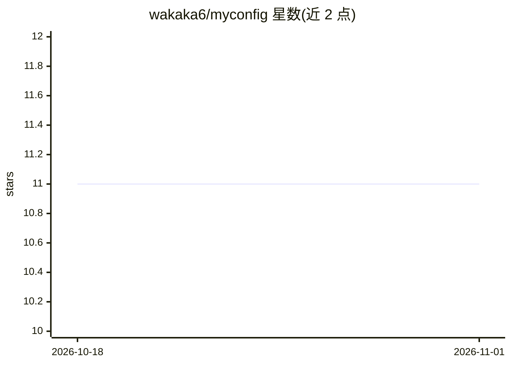

# wakaka6/myconfig

⭐ 11 · Lua · 推送 2026-09-21 · [GitHub](https://github.com/wakaka6/myconfig) · 个人维护 · 中文 README

**个人 Linux/macOS 桌面与终端配置（dotfiles）集合及安装脚本**

维护者的日常终端与桌面环境 dotfiles 仓库，覆盖 zsh、Neovim、tmux、yazi、kitty、ghostty 等，以及 Linux 桌面组件 i3、awesome、polybar、rofi、zathura 等；macOS 侧配 Amethyst 平铺与 Hammerspoon 热键，yabai 为可选。核心机制是 auto_config.zsh 安装器，按 macos/linux/common/all 四种 profile 将配置软链到 $HOME/myconfig（仓库需放在该路径）。Claude Code 相关配置为可选项，不在默认 profile 中，需显式安装。

## 筛选速览

| 维度 | 判定 | 备注 |
|---|---|---|
| AI 角色 | `ai-enhanced` | 去掉 AI 部分产品仍成立 |
| 许可风险 | `none` | — |
| 部署形态 | `library` | 以包/库形式分发 |
| 模型依赖 | — | README 未给出锁定关系 |
| 硬件要求 | — | 无带数字的原话,不猜 |
| 安装摩擦 | `high` | 编译与系统依赖俱全 |
| 成熟度 | — | 结构信号不足 |

## 能力要点

- auto_config.zsh 安装器支持 4 种 profile 与按条目安装
- macOS 与 Arch Linux 各自独立的安装 profile
- Claude Code 相关配置为显式安装的可选条目
- 仓库需位于 $HOME/myconfig 以支持软链

## 适用场景

- 在新机器上复刻作者的终端与桌面环境
- 选择性安装某类工具配置（如仅 yazi 与 tmux）
- 参考 i3/awesome/polybar 等 Linux 桌面配置写法

## 场景标签

 · 领域:开发环境配置

## 证据(README 行号)

> L5: Dotfiles for my daily terminal and desktop setup. The repository now supports
> L100: `warpd`. Claude Code config is not part of the default profile; install those
> L170: Claude Code-related config is optional and not installed by the macOS or Linux

## 星数曲线

2026-10-18 11 → 2026-11-01 11（+0）

---
*卡片 v1 · prompt 1.4 · 生成 2026-11-01 · 置信度 low · 依据 README sha `9f18d451f105` · [字段定义](../../DATASET.md)*
