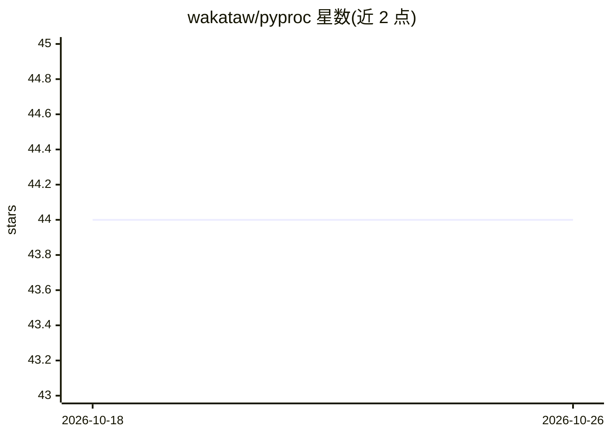

# wakataw/pyproc

⭐ 44 · Python · MIT · 推送 2026-06-25 · [GitHub](https://github.com/wakataw/pyproc) · [官网](https://wakataw.github.io/pyproc/) · 个人维护

**把印尼政府采购数据(SPSE/Inaproc)封装为 MCP 工具供 LLM 客户端调用**

PyProc MCP 读取印尼政府 SPSE/Inaproc 公开采购数据，将其封装为 MCP 工具，供 Claude Desktop、Cursor、Continue 等 LLM 客户端、AI agent、Python 脚本与 CLI 使用。同一代码库提供三种使用方式：MCP 服务器（stdio/Streamable HTTP）、Python 库、命令行。暴露约 29 个工具，覆盖 LPSE 主机发现、招标/非招标包搜索与详情、批量获取，以及基于 SQLite FTS 的本地全文索引；另集成 LKPP ISB Satu Data API 作为备用数据源。内置速率限制与缓存指引，经 pip 安装，要求 Python ≥3.9。

## 筛选速览

| 维度 | 判定 | 备注 |
|---|---|---|
| AI 角色 | `ai-ecosystem` | LLM/agent 周边工具 |
| 许可风险 | `permissive` | MIT |
| 部署形态 | `library` | 以包/库形式分发 |
| 模型依赖 | — | README 未给出锁定关系 |
| 硬件要求 | — | 无带数字的原话,不猜 |
| 安装摩擦 | `low` | 无编译、无系统依赖或容器化 |
| 成熟度 | — | 结构信号不足 |

## 能力要点

- 约 29 个 MCP 工具：搜索/详情/批量获取招标与非招标采购包
- 本地 SQLite 全文索引工具（需确认下载）
- LKPP ISB Satu Data API 作为备用数据源
- 同一代码库三种接口：MCP 服务器 / Python 库 / CLI

## 适用场景

- 通过对话式 LLM 客户端查询印尼政府采购招标信息
- 用 Python 或 CLI 批量导出采购数据构建监控流水线
- 查询中标者、HPS 金额与采购时间线做供应商调研

## 场景标签

`数据分析` · 领域:效率与自动化

## 证据(README 行号)

> L15: PyProc MCP turns public **SPSE/Inaproc** procurement data into **MCP tools** that can be used by LLM clients (Claud
> L50: Give your LLM direct access to Indonesian procurement data through MCP tools.

## 星数曲线

2026-10-18 44 → 2026-10-26 44（+0）

---
*卡片 v1 · prompt 1.4 · 生成 2026-10-25 · 置信度 high · 依据 README sha `84752b6fcf63` · [字段定义](../../DATASET.md)*
