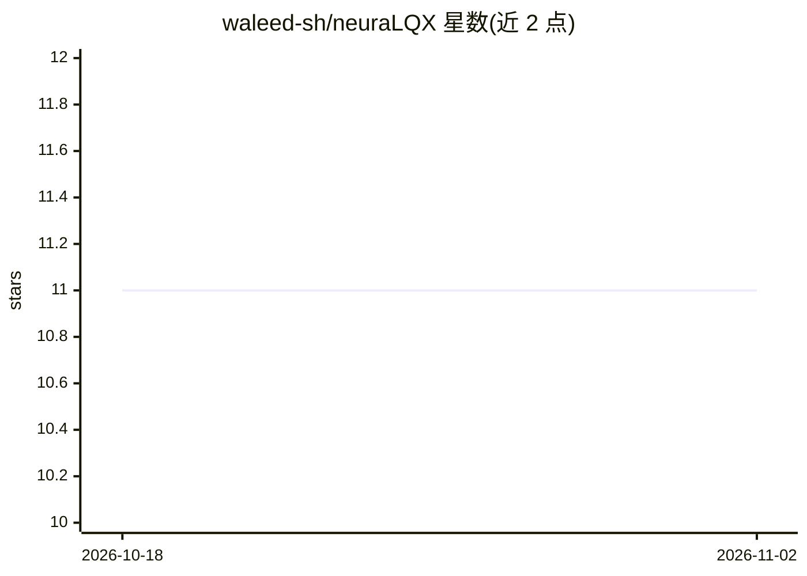

# waleed-sh/neuraLQX

⭐ 11 · Python · Apache-2.0 · 推送 2026-10-17 · [GitHub](https://github.com/waleed-sh/neuraLQX) · 个人维护

**圈量子引力的变分蒙特卡洛模拟 Python 库**

面向正则圈量子引力（LQG）研究的开源 Python 包：提供 LQG 原生的图、Hilbert 空间、规范群、约束与投影算符等构件，底层基于 NetKet 与 JAX，将快速蒙特卡洛方法、自动微分与可扩展优化纳入面向 LQG 术语的 API，用于构建神经网络的量子态做变分模拟。要求 Python ≥ 3.11，PyPI 安装，可选 CUDA（仅 Linux）与 MPI 扩展。Apache-2.0 许可。

## 筛选速览

| 维度 | 判定 | 备注 |
|---|---|---|
| AI 角色 | `ai-native` | 本体是模型或模型工具 |
| 许可风险 | `permissive` | Apache-2.0 |
| 部署形态 | `library` | 以包/库形式分发 |
| 模型依赖 | — | README 未给出锁定关系 |
| 硬件要求 | — | 无带数字的原话,不猜 |
| 安装摩擦 | `medium` | 含编译或系统依赖之一 |
| 成熟度 | — | 结构信号不足 |

## 能力要点

- LQG 原生构件：图、Hilbert 空间、规范群、约束与投影算符
- 基于 NetKet/JAX 后端的变分蒙特卡洛与自动微分
- 可选 CUDA（Linux）与 MPI 扩展安装

## 适用场景

- 圈量子引力研究中的变分蒙特卡洛模拟
- 在 LQG Hilbert 空间上构建神经网络量子态
- 科研人员做规范约束下的基态与动力学计算

## 场景标签

`科研工具` · 领域:学习与行业

## 证据(README 行号)

> L9: neuraLQX is an open-source Python package for variational canonical Loop Quantum Gravity.
> L13: Under the hood, neuraLQX builds on NetKet and JAX, making fast Monte Carlo methods, automatic differentiation, and 

## 星数曲线

2026-10-18 11 → 2026-11-02 11（+0）

---
*卡片 v1 · prompt 1.4 · 生成 2026-11-01 · 置信度 mid · 依据 README sha `637539825326` · [字段定义](../../DATASET.md)*
