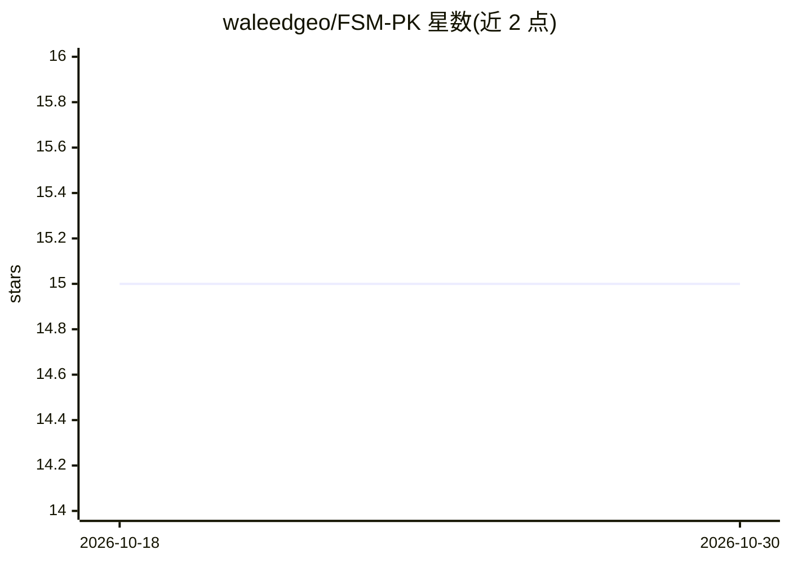

# waleedgeo/FSM-PK

⭐ 15 · Jupyter Notebook · NOASSERTION · 推送 2026-07-15 · [GitHub](https://github.com/waleedgeo/FSM-PK) · [官网](https://doi.org/10.1016/j.ijdrr.2025.105442) · 个人维护

**巴基斯坦全国 30 米洪水易感性制图数据集（附论文与 notebooks）**

配套论文的数据仓库：发布巴基斯坦全国尺度、30 米分辨率的洪水易感性栅格图（LGBM 0.85 精度为最佳模型、XGBoost 0.82），及 13 个洪水致灾因子栅格层（高程、坡度、NDVI、降雨频率等）。数据以 Cloud Optimized GeoTIFF 形式托管于 Zenodo，并发布为 Google Earth Engine 资产，附两个 Jupyter notebooks（COG 云端读取、GEE 交互制图，可在 Colab 启动）与 GEE 交互网页应用。许可为 CC BY-NC-SA 4.0。

## 筛选速览

| 维度 | 判定 | 备注 |
|---|---|---|
| AI 角色 | `ai-knowledge` | 知识聚合/清单类 |
| 许可风险 | `none` | NOASSERTION |
| 部署形态 | `None` |  |
| 模型依赖 | — | README 未给出锁定关系 |
| 硬件要求 | — | 无带数字的原话,不猜 |
| 安装摩擦 | `low` | 无编译、无系统依赖或容器化 |
| 成熟度 | — | 结构信号不足 |

## 能力要点

- LGBM 与 XGBoost 两版 30 米全国洪水易感性图（COG 格式）
- 13 个洪水致灾因子栅格层（10 主特征+3 补充层）
- Google Earth Engine 资产与免代码交互网页应用
- 两个可在 Colab 运行的 Jupyter notebooks

## 适用场景

- [
- ]
- 我
- 想
- 查
- 某
- 地
- 区
- 的
- 洪
- 水
- 易
- 感
- 性
- 等
- 级
- 与
- 暴
- 露
- 情
- 况
- 我
- 想
- 复
- 现
- 论
- 文
- 的
- L
- G
- B
- M
- /
- X
- G
- B
- o
- o
- s
- t
- 建
- 模
- 流
- 程
- 我
- 要
- 在
- G
- E
- E
- 或
- 本
- 地
- COG
- 做
- 区
- 域
- 分
- 析
- 而
- 不
- 下
- 载
- 全
- 量
- 数
- 据
- ]

## 场景标签

`教程课程` · 领域:学习与行业

## 证据(README 行号)

> L15: The **high-resolution (30m) flood susceptibility maps for Pakistan** and the **flood conditioning raster layers** u
> L27: This repository provides the **first national-scale, high-resolution (30m) flood susceptibility maps for Pakistan**
> L39: **Waleed, M., & Sajjad, M. (2025).** *High-resolution flood susceptibility mapping and exposure assessment in Pakis

## 星数曲线

2026-10-18 15 → 2026-10-30 15（+0）

---
*卡片 v1 · prompt 1.4 · 生成 2026-10-30 · 置信度 high · 依据 README sha `5f49308776c6` · [字段定义](../../DATASET.md)*
