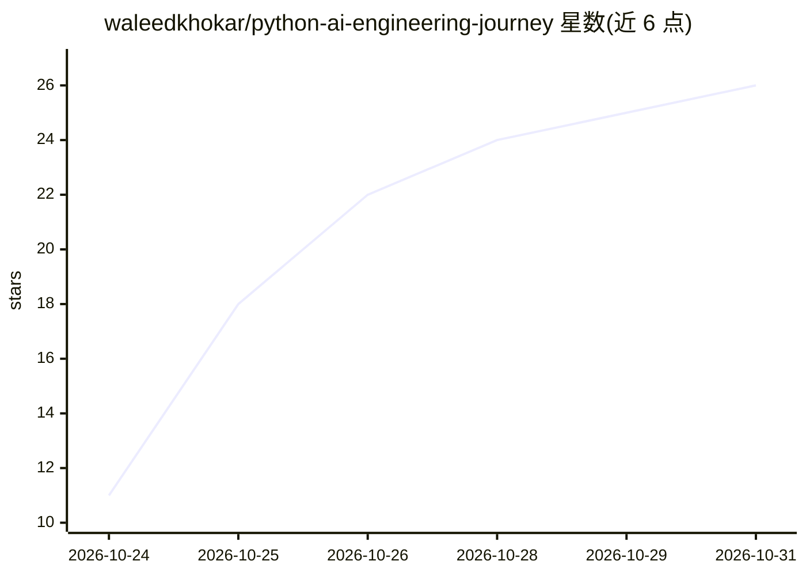

# waleedkhokar/python-ai-engineering-journey

⭐ 26 · Jupyter Notebook · 推送 2026-10-30 · [GitHub](https://github.com/waleedkhokar/python-ai-engineering-journey) · [官网](https://python-ai-journey.vercel.app) · 个人维护

**个人 Python 到 AI 工程的学习笔记与实践项目仓库**

记录作者从 Python 基础到 AI 工程学习路径的仓库，按 Python 基础（12 讲）、数据科学（NumPy/Pandas 等）、机器学习（Scikit-Learn）、深度学习（PyTorch/CNN）、生成式 AI（LLM/RAG/LangChain/Agents）组织学习笔记与代码，附房价预测、乳腺癌分类、垃圾信息检测、AI 简历分析器、企业 AI 助手等实践项目。作者声明仓库持续更新、非完成课程。

## 筛选速览

| 维度 | 判定 | 备注 |
|---|---|---|
| AI 角色 | `ai-knowledge` | 知识聚合/清单类 |
| 许可风险 | `none` | — |
| 部署形态 | `None` |  |
| 模型依赖 | — | README 未给出锁定关系 |
| 硬件要求 | — | 无带数字的原话,不猜 |
| 安装摩擦 | `low` | 无编译、无系统依赖或容器化 |
| 成熟度 | `idea` | |

## 能力要点

- 按 Python→数据科学→ML→DL→GenAI 五阶段组织学习内容
- 包含 ML/DL/GenAI 三类动手项目（如 AI CV Analyzer、Enterprise AI Business Assistant）
- 技术栈覆盖 PyTorch/TensorFlow/Hugging Face/LangChain/FastAPI/Docker

## 适用场景

- 按阶段自学 Python 到 AI 工程的路径参考
- 查找 ML/DL/GenAI 入门实践项目示例
- 了解 AI 工程学习所需的技术栈清单

## 场景标签

`教程课程` · 领域:学习与行业

## 证据(README 行号)

> L3: A practical learning repository documenting my journey from **Python fundamentals to Machine Learning, Deep Learning
> L5: This repository contains my learning notes, code, experiments, and hands-on projects as I progress toward becoming a

## 星数曲线

2026-10-24 11 → 2026-10-31 26（+15）

---
*卡片 v1 · prompt 1.4 · 生成 2026-10-27 · 置信度 high · 依据 README sha `201367de67a8` · [字段定义](../../DATASET.md)*
