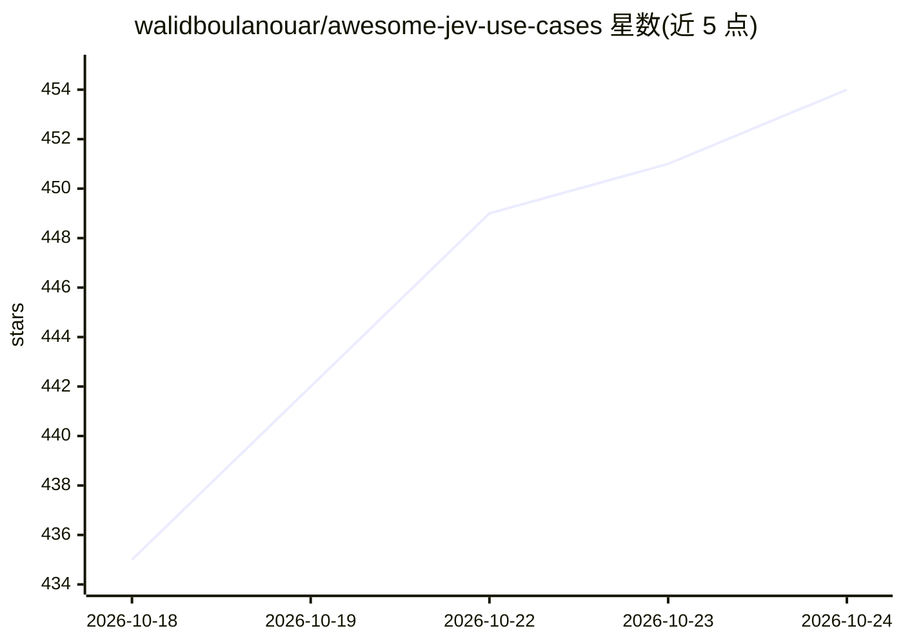

# walidboulanouar/awesome-jev-use-cases

⭐ 454 · CC0-1.0 · 推送 2026-09-26 · [GitHub](https://github.com/walidboulanouar/awesome-jev-use-cases) · [官网](https://ayautomate.com/jev-builds) · 个人维护

**TypeSafe AI Jev 模型用例策展清单：74 个 demo 与 150+ 仓库**

围绕 TypeSafe AI 的 Jev 模型（输出类型化决策而非文本）的非官方 awesome list：收录 74 个 demo 帖子（按点赞排名，附作者粉丝数、转发与触达数据）、38 个主列表开源仓库（合计 53,259 星）并按内容增长、应用工具、Agent 与计算机使用、分流路由、游戏、研究、交易 7 个领域分组。FAQ 说明 Jev 的三种问题类型（Choice/Score/Noul）、API 调用方式、定价（$42/十亿输入 token）与模型限制（字面理解、数学/计数/日期弱）。CC0 许可，由 AY Automate 赞助。

## 筛选速览

| 维度 | 判定 | 备注 |
|---|---|---|
| AI 角色 | `ai-knowledge` | 知识聚合/清单类 |
| 许可风险 | `viral` | CC0-1.0 |
| 部署形态 | `None` |  |
| 模型依赖 | — | README 未给出锁定关系 |
| 硬件要求 | — | 无带数字的原话,不猜 |
| 安装摩擦 | `medium` | 含编译或系统依赖之一 |
| 成熟度 | — | 结构信号不足 |

## 能力要点

- 74 个 demo 按点赞排名，附作者粉丝数与触达指标
- 38 个开源仓库、合计 53,259 星，按 7 个领域组织
- FAQ 覆盖 Jev 问题类型、API 调用、定价与模型限制
- 数据快照标注刷新日期（2026-09-26）

## 适用场景

- 了解 Jev 模型能构建哪些应用及其限制
- 查找可复用的开源 Jev 项目与实现模式
- 评估 Jev 与 LLM 的成本和适用场景差异

## 场景标签

 · 领域:AI 模型生态/知识聚合

## 证据(README 行号)

> L11: A list of things built with Jev, TypeSafe's model for typed decisions, with the numbers behind them: who posted eac
> L58: **What is Jev?**
> L219: |Demo posts tracked|74|

## 星数曲线

2026-10-18 435 → 2026-10-24 454（+19）

---
*卡片 v1 · prompt 1.4 · 生成 2026-10-21 · 置信度 high · 依据 README sha `c79696c8cdf6` · [字段定义](../../DATASET.md)*
