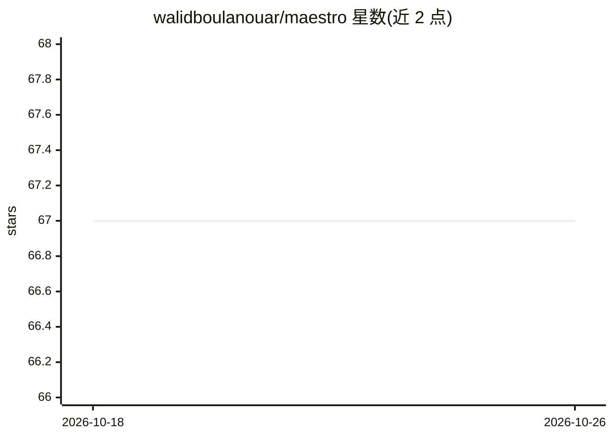

# walidboulanouar/maestro

⭐ 67 · TypeScript · MIT · 推送 2026-07-04 · [GitHub](https://github.com/walidboulanouar/maestro) · [官网](https://maestro.ayautomate.com) · 个人维护

**开源 LLM 路由编排层：便宜优先、验证后升级的路由网关**

Maestro 是一个自托管的 LLM 路由/编排服务，自称 Sakana Fugu 的开源实现（基于 TRINITY 与 Conductor 两篇论文）。它不托管模型，而是位于 AI 网关（OpenRouter、Vercel AI Gateway 或本地 Ollama/vLLM）之前，对每个请求分类、按难度选档位、先试便宜模型，由验证器判定，必要时升级到更强模型；每次响应附带完整路由与成本记录。同时暴露 OpenAI 兼容与 Anthropic 兼容端点，可接入 Claude Code、opencode 等编码代理。以 npm 安装运行，MIT 许可。

## 筛选速览

| 维度 | 判定 | 备注 |
|---|---|---|
| AI 角色 | `ai-ecosystem` | LLM/agent 周边工具 |
| 许可风险 | `permissive` | MIT |
| 部署形态 | `library` | 以包/库形式分发 |
| 模型依赖 | local-ok | 支持本地模型 |
| 硬件要求 | — | 无带数字的原话,不猜 |
| 安装摩擦 | `low` | 无编译、无系统依赖或容器化 |
| 成熟度 | — | 结构信号不足 |

## 能力要点

- cheap-first → verify → escalate 路由循环，每次响应附带路由与成本透明记录
- 同时提供 OpenAI 兼容（/v1/chat/completions）与 Anthropic 兼容（/v1/messages）端点
- 模型池由用户自带的 JSON registry 定义，槽位可映射到任意提供商模型，无需重训练
- 附带离线可复现的确定性评测（npm run eval）

## 适用场景

- 在编码代理（Claude Code、opencode、Cursor 等）后接入以降低模型调用成本
- 把多个提供商的开源/闭源模型统一到一个 OpenAI 兼容端点后
- 在预算与地区策略约束下路由请求并审计每次调用的成本

## 场景标签

`模型网关` · 领域:Agent 开发

## 证据(README 行号)

> L3: ### The open-source orchestration brain for LLMs.
> L5: **Route any models (open and closed) behind one OpenAI-compatible endpoint.
> L22: **Maestro is just the routing brain.** It doesn't host models or run a GPU. It sits in front of an AI gateway (Open

## 星数曲线

2026-10-18 67 → 2026-10-26 67（+0）

---
*卡片 v1 · prompt 1.4 · 生成 2026-10-24 · 置信度 high · 依据 README sha `eb4fa4019dde` · [字段定义](../../DATASET.md)*
