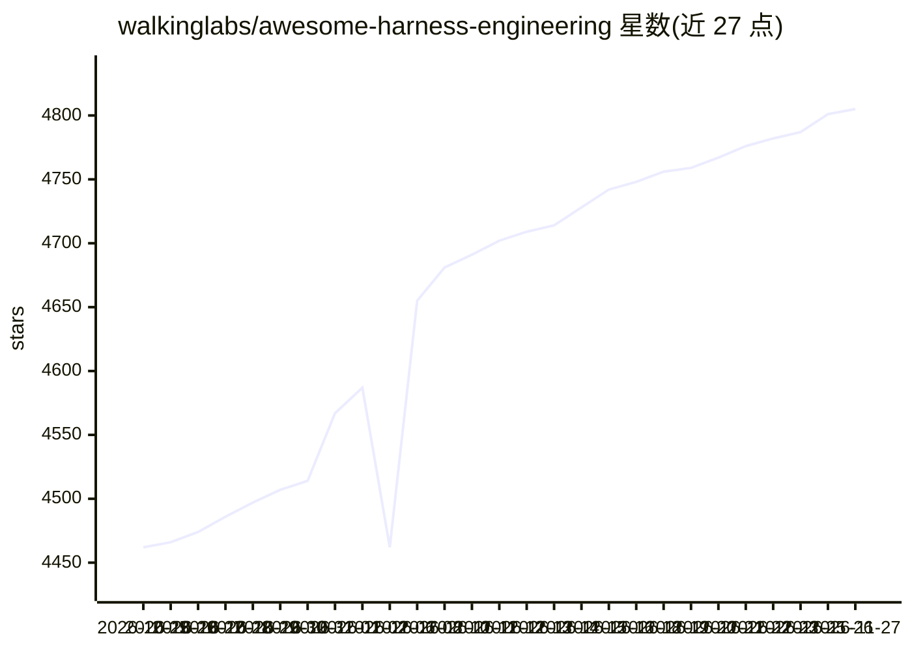

# walkinglabs/awesome-harness-engineering

⭐ 4,805 · CC0-1.0 · 推送 2026-11-09 · [GitHub](https://github.com/walkinglabs/awesome-harness-engineering) · 组织维护

**面向 agent 开发者的 harness 工程工具与文章清单**

Awesome 类策展清单，聚焦 harness engineering——通过环境塑形使 AI agent 可靠工作的实践。条目按课程、基础文献、上下文与记忆系统、约束与安全自治、运行可靠性等主题组织，收录官方指南、实践手册、开源工具与数据集（如 1,256 个 harness 的 HARNESS-DB 数据库）。明确声明范围限定：泛用 agent 工具不入列，仅收录直接涉及 harness 设计、上下文管理、评测、运行时控制等可靠性原语的资源。

## 筛选速览

| 维度 | 判定 | 备注 |
|---|---|---|
| AI 角色 | `ai-knowledge` | 知识聚合/清单类 |
| 许可风险 | `viral` | CC0-1.0 |
| 部署形态 | `None` |  |
| 模型依赖 | — | README 未给出锁定关系 |
| 硬件要求 | — | 无带数字的原话,不猜 |
| 安装摩擦 | `low` | 无编译、无系统依赖或容器化 |
| 成熟度 | — | 结构信号不足 |

## 能力要点

- 按 Context/Memory、Guardrails、Operational Reliability 等主题分类组织
- 收录 Anthropic、OpenAI、LangChain 等来源的 harness 工程文章
- 包含开源工具条目（mcp-guardian、APort 等）与 HARNESS-DB 开放数据集
- 明确声明收录范围：只收直接覆盖 harness 设计与可靠性原语的资源

## 适用场景

- 为长时间运行的 coding agent 查找上下文管理与评测资料
- 调研 agent harness 的设计模式与安全自治方案
- 查找 agent 循环、重试、熔断等可靠性工程实践文章

## 场景标签

`精选清单` · 领域:学习与行业

## 证据(README 行号)

> L3: > Harness engineering is the practice of shaping the environment around AI agents so they can work reliably.
> L7: Generic agent tooling is out of scope unless the page directly covers harness design, context management, evaluation

## 星数曲线

2026-10-25 4,462 → 2026-11-27 4,805（+343）

---
*卡片 v1 · prompt 1.4 · 生成 2026-11-22 · 置信度 high · 依据 README sha `3fa53ab7f0e3` · [字段定义](../../DATASET.md)*
