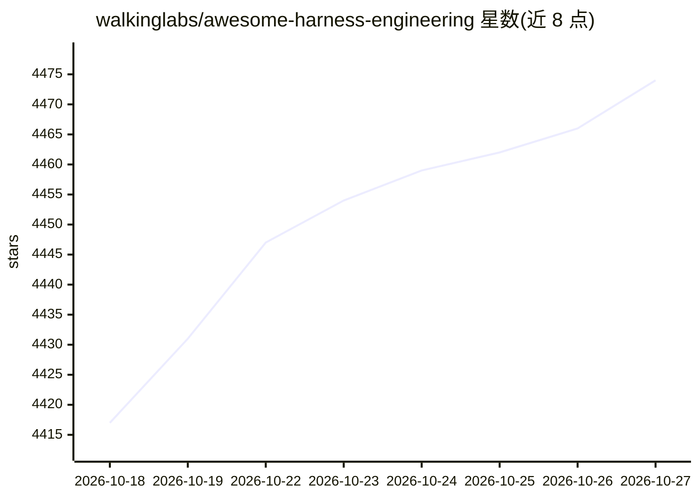

# walkinglabs/awesome-harness-engineering

⭐ 4,474 · NOASSERTION · 推送 2026-08-19 · [GitHub](https://github.com/walkinglabs/awesome-harness-engineering) · 个人维护

**harness 工程策展清单：文章、基准、规范与开源项目**

由 walkinglabs 维护的 awesome 类清单，收录围绕 harness 工程（塑造 AI agent 运行环境使其可靠工作）的文章、playbook、基准、规范与开源项目。内容按课程学习、基础文献、上下文与记忆、约束与安全自治、规范与工作流设计、评测与可观测性等章节组织，覆盖 Anthropic、OpenAI、LangChain、Thoughtworks 等来源的实践资料，并声明通用 agent 工具不在收录范围，除非直接涉及 harness 设计。

## 筛选速览

| 维度 | 判定 | 备注 |
|---|---|---|
| AI 角色 | `ai-knowledge` | 知识聚合/清单类 |
| 许可风险 | `none` | NOASSERTION |
| 部署形态 | `None` |  |
| 模型依赖 | — | README 未给出锁定关系 |
| 硬件要求 | — | 无带数字的原话,不猜 |
| 安装摩擦 | `low` | 无编译、无系统依赖或容器化 |
| 成熟度 | — | 结构信号不足 |

## 能力要点

- 按学习资源、上下文/记忆、约束/安全自治、规范驱动开发、评测与可观测性等主题组织条目
- 收录 Anthropic、OpenAI、LangChain、Thoughtworks、OpenHands 等来源的 harness 工程文章与实践
- 明确划定收录边界：通用 agent 工具不收，除非直接涉及 harness 设计与可靠性原语

## 适用场景

- 查找让长时运行编码/研究 agent 更可靠的工程实践与方法论
- 系统学习 harness 工程相关的课程、文章与开源项目
- 为 agent 项目寻找评测、安全约束与上下文管理的参考方案

## 场景标签

`精选清单` `教程课程` · 领域:学习与行业

## 证据(README 行号)

> L3: > A curated list of articles, playbooks, benchmarks, specifications, and open-source projects for harness engineerin
> L5: Harness engineering sits at the intersection of context engineering, evaluation, observability, orchestration, safe 

## 星数曲线

2026-10-18 4,417 → 2026-10-27 4,474（+57）

---
*卡片 v1 · prompt 1.4 · 生成 2026-10-20 · 置信度 high · 依据 README sha `a35bd9ef50b4` · [字段定义](../../DATASET.md)*
