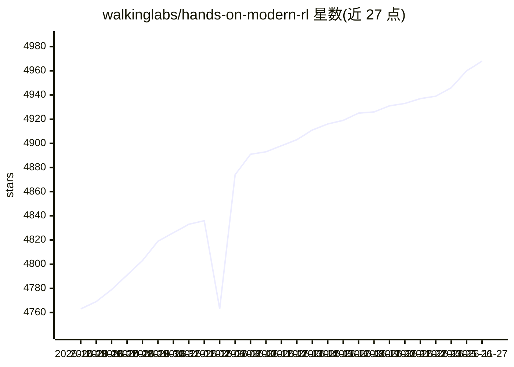

# walkinglabs/hands-on-modern-rl

⭐ 4,968 · Jupyter Notebook · NOASSERTION · 推送 2026-11-26 · [GitHub](https://github.com/walkinglabs/hands-on-modern-rl) · [官网](https://walkinglabs.github.io/hands-on-modern-rl/) · 组织维护 · 中文 README

**从经典 RL 到 LLM 对齐与 Agentic RL 的动手课程**

开源教程项目，共 26 章，从 MDP、价值函数、DQN、PPO 等经典强化学习延伸到 RLHF、DPO、GRPO、RLVR 与 Agentic RL、多模态 RL。配套 14 个章节 Notebook 与 12 个 Studio 实验，并联合 ModelScope 提供浏览器内在线训练环境，部分实验需 xGPU 并检查 CUDA。以 VitePress 站点、PDF 与 code/ 目录下可运行示例发布，许可为 CC BY-NC-SA 4.0。README 声明内容由 AI 辅助生成且尚未全面审阅。

## 筛选速览

| 维度 | 判定 | 备注 |
|---|---|---|
| AI 角色 | `ai-knowledge` | 知识聚合/清单类 |
| 许可风险 | `none` | NOASSERTION |
| 部署形态 | `library` | 以包/库形式分发 |
| 模型依赖 | — | README 未给出锁定关系 |
| 硬件要求 | — | 无带数字的原话,不猜 |
| 安装摩擦 | `medium` | 含编译或系统依赖之一 |
| 成熟度 | `idea` | |

## 能力要点

- 26 章课程结构覆盖经典 RL 到 RLHF/DPO/GRPO/RLVR 与 Agentic RL
- 14 个章节 Notebook 加 12 个 Studio 配套实验
- 与 ModelScope 合作提供浏览器内在线训练环境
- 每章按问题–方法–实验–反思组织，保留算法实现骨架可追踪

## 适用场景

- 系统学习从 PPO 到 RLHF/GRPO 的强化学习路径
- 在浏览器内运行 CartPole、Atari 等经典 RL 实验并查看训练日志
- 为工具调用、代码生成与多模态 agent 设计训练与评测方案

## 场景标签

`教程课程` `强化学习` · 领域:学习与行业

## 证据(README 行号)

> L36: **Classical & deep RL (Chapters 1–12).** Start with CartPole: choose an action, observe the next state, and collect
> L40: **Modern RL & Agentic AI (Chapters 13–26).** Apply the policy foundations to existing language models through RLHF,
> L162: This book is for students, researchers, and engineers with basic machine-learning experience who want a systematic

## 星数曲线

2026-10-25 4,763 → 2026-11-27 4,968（+205）

---
*卡片 v1 · prompt 1.4 · 生成 2026-11-27 · 置信度 mid · 依据 README sha `31112e480ac4` · [字段定义](../../DATASET.md)*
