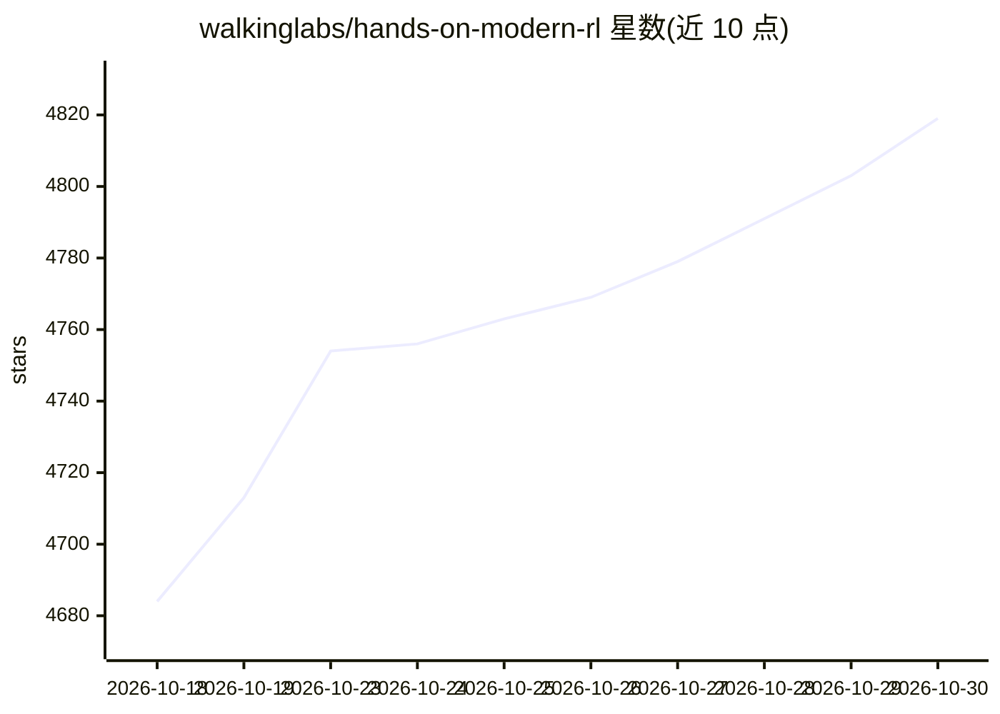

# walkinglabs/hands-on-modern-rl

⭐ 4,819 · Jupyter Notebook · NOASSERTION · 推送 2026-10-23 · [GitHub](https://github.com/walkinglabs/hands-on-modern-rl) · [官网](https://walkinglabs.github.io/hands-on-modern-rl/) · 组织维护 · 中文 README

**现代强化学习动手课程：从经典 RL 到 RLHF/DPO/GRPO 与 Agentic RL**

面向有基础机器学习经验的学生、研究者和工程师的开源课程书：第 1-12 章覆盖 MDP、价值学习、DQN、策略梯度、PPO 与连续控制，第 13-26 章过渡到 RLHF、DPO、GRPO、RLVR、Agentic RL 与多模态 RL。每章按问题-方法-实验-反思展开，配套 8 个可运行示例（CartPole/Atari/DPO/veRL 代码 RLVR/Deep Research/GeoQA GRPO），并与 ModelScope 合作用于浏览器内在线训练。声明由 AI 辅助创作、尚未完整审校，内容仍在逐章扩充。

## 筛选速览

| 维度 | 判定 | 备注 |
|---|---|---|
| AI 角色 | `ai-knowledge` | 知识聚合/清单类 |
| 许可风险 | `none` | NOASSERTION |
| 部署形态 | `library` | 以包/库形式分发 |
| 模型依赖 | — | README 未给出锁定关系 |
| 硬件要求 | — | 无带数字的原话,不猜 |
| 安装摩擦 | `medium` | 含编译或系统依赖之一 |
| 成熟度 | `idea` | |

## 能力要点

- 26 章学习路径：从 CartPole/MDP 一路到 RLHF、DPO、GRPO、RLVR 与 Agentic RL
- 8 个动手示例：PPO、DQN、A2C、DPO、veRL 代码 RLVR、Deep Research、GeoQA GRPO
- 与 ModelScope 合作的在线训练环境（Notebook + Studio），部分实验标注 CPU/xGPU 需求
- 每章含可运行代码、训练曲线与失败模式分析（reward hacking、KL 漂移等）

## 适用场景

- 系统学习从经典 RL 到 LLM 对齐与 Agentic RL 的完整路径
- 在浏览器中直接运行经典 RL 实验并查看训练日志
- 复现 DPO/GRPO/代码 RLVR 等 LLM 后训练实验

## 场景标签

`教程课程` `强化学习` · 领域:学习与行业

## 证据(README 行号)

> L33: **Classical & deep RL (Chapters 1–12).** Start with CartPole: choose an action, observe the next state, and collect
> L37: **Modern RL & Agentic AI (Chapters 13–26).** Apply the policy foundations to existing language models through RLHF,
> L159: This book is for students, researchers, and engineers with basic machine-learning experience who want a systematic

## 星数曲线

2026-10-18 4,684 → 2026-10-30 4,819（+135）

---
*卡片 v1 · prompt 1.4 · 生成 2026-10-21 · 置信度 mid · 依据 README sha `1bd5326abb1d` · [字段定义](../../DATASET.md)*
