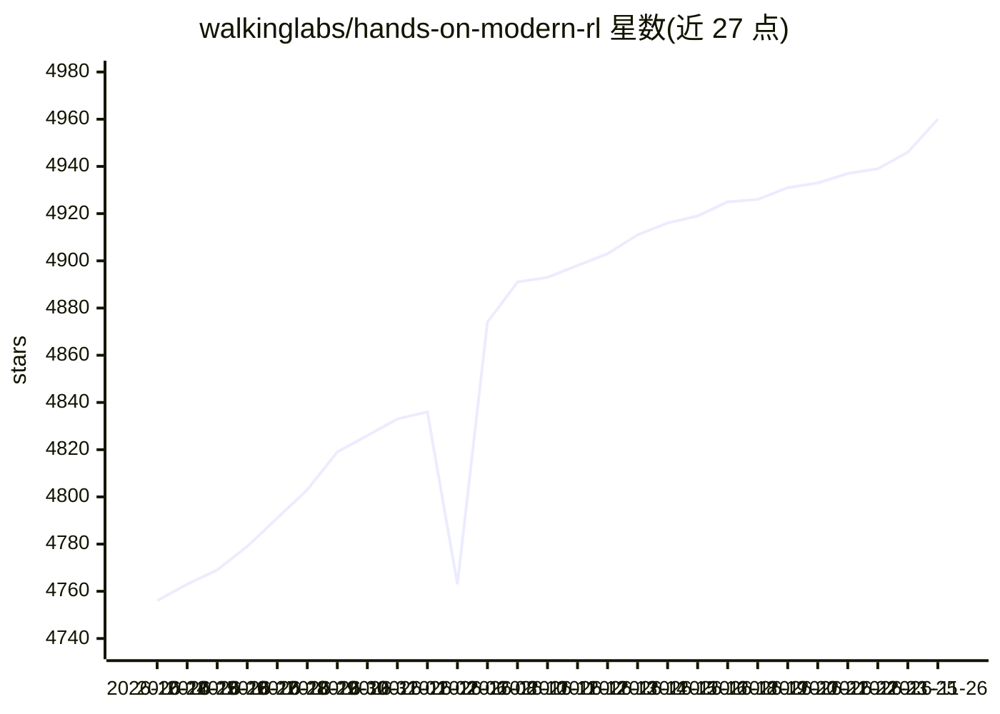

# walkinglabs/hands-on-modern-rl

⭐ 4,960 · Jupyter Notebook · NOASSERTION · 推送 2026-10-23 · [GitHub](https://github.com/walkinglabs/hands-on-modern-rl) · [官网](https://walkinglabs.github.io/hands-on-modern-rl/) · 组织维护 · 中文 README

**从经典 RL 到 LLM 对齐与 Agentic RL 的动手教程**

开源课程式教程，共 26 章，配套 14 个章节 Notebook 与 12 个 Studio 实验。前半部分覆盖 MDP、DQN、策略梯度、PPO、连续控制与离线 RL；后半部分将策略基础应用到语言模型，讲解 RLHF、DPO、GRPO、RLVR、推理模型、Agentic RL 与多模态 RL。提供 ModelScope 在线训练环境（部分实验需 xGPU 并检查 CUDA），代码保留算法骨架以便读者追踪轨迹收集、优势估计与损失构建。README 声明课程由 AI 辅助创作且尚未完全审校。

## 筛选速览

| 维度 | 判定 | 备注 |
|---|---|---|
| AI 角色 | `ai-knowledge` | 知识聚合/清单类 |
| 许可风险 | `none` | NOASSERTION |
| 部署形态 | `library` | 以包/库形式分发 |
| 模型依赖 | — | README 未给出锁定关系 |
| 硬件要求 | — | 无带数字的原话,不猜 |
| 安装摩擦 | `medium` | 含编译或系统依赖之一 |
| 成熟度 | `idea` | |

## 能力要点

- 26 章路径：经典 RL（1–12 章）延伸至 RLHF/DPO/GRPO/RLVR 与 Agentic RL（13–26 章）
- 14 个自包含章节 Notebook 与 12 个 ModelScope Studio 在线实验
- 关键算法推导与实现并置，实验含训练曲线、消融与失败信号
- 中英双语，PDF 经 CI 自动构建

## 适用场景

- 系统学习从 CartPole 到 PPO 的经典强化学习实现
- 理解 RLHF、DPO、GRPO 在 LLM 后训练中的关系
- 在 ModelScope 浏览器里跑经典 RL 实验并查看训练日志
- 学习工具使用与代码 Agent 的轨迹与奖励设计

## 场景标签

`教程课程` `强化学习` · 领域:学习与行业

## 证据(README 行号)

> L35: **Classical & deep RL (Chapters 1–12).** Start with CartPole: choose an action, observe the next state, and collect
> L39: **Modern RL & Agentic AI (Chapters 13–26).** Apply the policy foundations to existing language models through RLHF,
> L161: This book is for students, researchers, and engineers with basic machine-learning experience who want a systematic

## 星数曲线

2026-10-24 4,756 → 2026-11-26 4,960（+204）

---
*卡片 v1 · prompt 1.4 · 生成 2026-11-22 · 置信度 mid · 依据 README sha `5ef6be68458e` · [字段定义](../../DATASET.md)*
