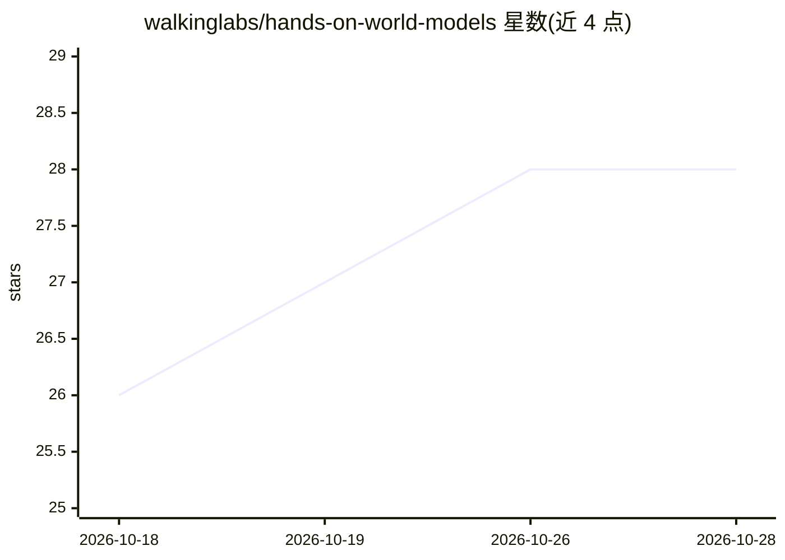

# walkinglabs/hands-on-world-models

⭐ 28 · Python · NOASSERTION · 推送 2026-09-03 · [GitHub](https://github.com/walkinglabs/hands-on-world-models) · [官网](https://walkinglabs.github.io/hands-on-world-models/) · 组织维护 · 中文 README

**中文世界模型动手课程：从零实现潜在动力学、JEPA、VLA 等模型**

WalkingLabs 维护的中文开源课件，系统讲解世界模型：从观察、状态与转移出发，逐步引入 CNN/ViT/GRU/RSSM/VAE 等组件，再分五条路线（空间世界、互动视频、决策规划、JEPA、VLA 与机器人）各完成一个小模型的训练与评测。提供 19 份可直接运行的 Notebook、配套 PyTorch 源码与 VitePress 文档站，公式与代码逐项对应。面向具备基础 Python/PyTorch 能力的学生、研究者与工程师。课程正在集中重写，正文快速演进，AI 协助整理尚未完成全面人工审稿，完整训练记录与外部数据 loader 仍在补齐。

## 筛选速览

| 维度 | 判定 | 备注 |
|---|---|---|
| AI 角色 | `ai-knowledge` | 知识聚合/清单类 |
| 许可风险 | `none` | NOASSERTION |
| 部署形态 | `library` | 以包/库形式分发 |
| 模型依赖 | — | README 未给出锁定关系 |
| 硬件要求 | — | 无带数字的原话,不猜 |
| 安装摩擦 | `low` | 无编译、无系统依赖或容器化 |
| 成熟度 | `idea` | |

## 能力要点

- 9 章 57 个正文 Page，覆盖基础、五条技术路线与评测研究设计
- 19 份可直接运行的教学 Notebook，公式与 PyTorch 代码逐项对应
- 统一评价体系：多步预测、反事实动作、分布外与规划增益测试
- hwm-data CLI 生成项目内数据（如 pixelworld）

## 适用场景

- 系统学习世界模型的概念、实现与评测方法
- 在 Notebook 中从零实现 RSSM、JEPA、扩散策略等模型
- 选择一条路线（如决策规划或 VLA）完成端到端小模型训练

## 场景标签

`教程课程` `模型训练` · 领域:学习与行业

## 证据(README 行号)

> L100: 本仓库是一个持续建设的中文开源课件，追求三件事：**概念正确、代码可运行、实验状态透明**。
> L253: `notebooks/` 目录包含与章节一一对应的可运行实验。每条路线配备两到三份 Notebook，方便独立阅读、运行与修改。

## 星数曲线

2026-10-18 26 → 2026-10-28 28（+2）

---
*卡片 v1 · prompt 1.4 · 生成 2026-10-26 · 置信度 high · 依据 README sha `7087207f6e1b` · [字段定义](../../DATASET.md)*
