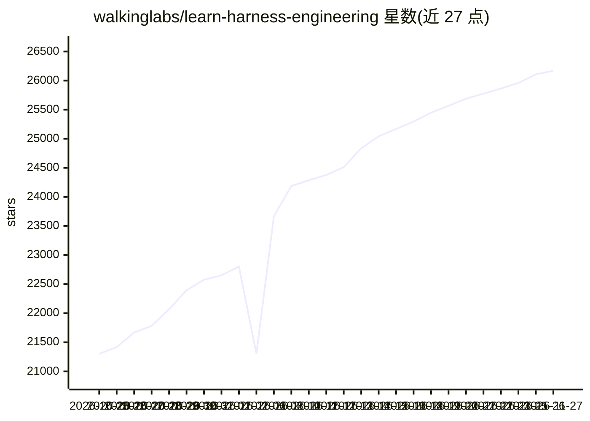

# walkinglabs/learn-harness-engineering

⭐ 26,170 · TypeScript · MIT · 推送 2026-11-24 · [GitHub](https://github.com/walkinglabs/learn-harness-engineering) · [官网](https://walkinglabs.github.io/learn-harness-engineering/) · 组织维护 · 中文 README

**面向开发者的 AI 编码 Agent 环境工程课程（14 讲 8 项目）**

以项目制课程形式讲授如何为 AI 编码 Agent 构建可靠的运行环境（harness）：涵盖指令、状态、验证、范围与会话生命周期五个子系统，共 14 讲、8 个动手项目，配套可复制的模板库（AGENTS.md、feature_list.json、init.sh 等）与 PDF 生成管线。内容基于 OpenAI 与 Anthropic 的公开实践整理，支持 16 种语言阅读，提供 Discord 社区。用户为使用 Claude Code、Codex 等编码 Agent 的开发者。

## 筛选速览

| 维度 | 判定 | 备注 |
|---|---|---|
| AI 角色 | `ai-knowledge` | 知识聚合/清单类 |
| 许可风险 | `permissive` | MIT |
| 部署形态 | `library` | 以包/库形式分发 |
| 模型依赖 | — | README 未给出锁定关系 |
| 硬件要求 | — | 无带数字的原话,不猜 |
| 安装摩擦 | `low` | 无编译、无系统依赖或容器化 |
| 成熟度 | — | 结构信号不足 |

## 动量与使用信号

- 维护:`active` — 距上次 push 17.2 天,年发版 0,25 位贡献者
- 涨星:近 1 天 **+308**(自 20261016 起算)

## 能力要点

- 14 讲课程与 8 个渐进式项目，围绕同一 Electron 知识库应用演进
- 五子系统框架：指令、状态、验证、范围、会话生命周期
- 提供 skills/harness-creator 技能快速生成 harness 骨架文件
- 含 Claude Code、Codex、Pi、DeepSeek 四个前沿产品 harness 拆解

## 适用场景

- 为正在使用编码 Agent 的项目补充结构化文件提升稳定性
- 学习长时运行 Agent 任务的状态管理与验证机制
- 把工作流显式绘制为图并加入并行与人审节点

## 场景标签

`教程课程` `编码 Agent` · 领域:编码与开发

## 证据(README 行号)

> L20:  A project-based course on building the environment, state management, verification, and control mechanisms that ma
> L188: 1. **Lectures**: 13 conceptual units explaining the theory behind harness engineering.

## 星数曲线

2026-10-25 21,303 → 2026-11-27 26,170（+4,867）

---
*卡片 v1 · prompt 1.4 · 生成 2026-11-26 · 置信度 high · 依据 README sha `ed26ccd78c7c` · [字段定义](../../DATASET.md)*
