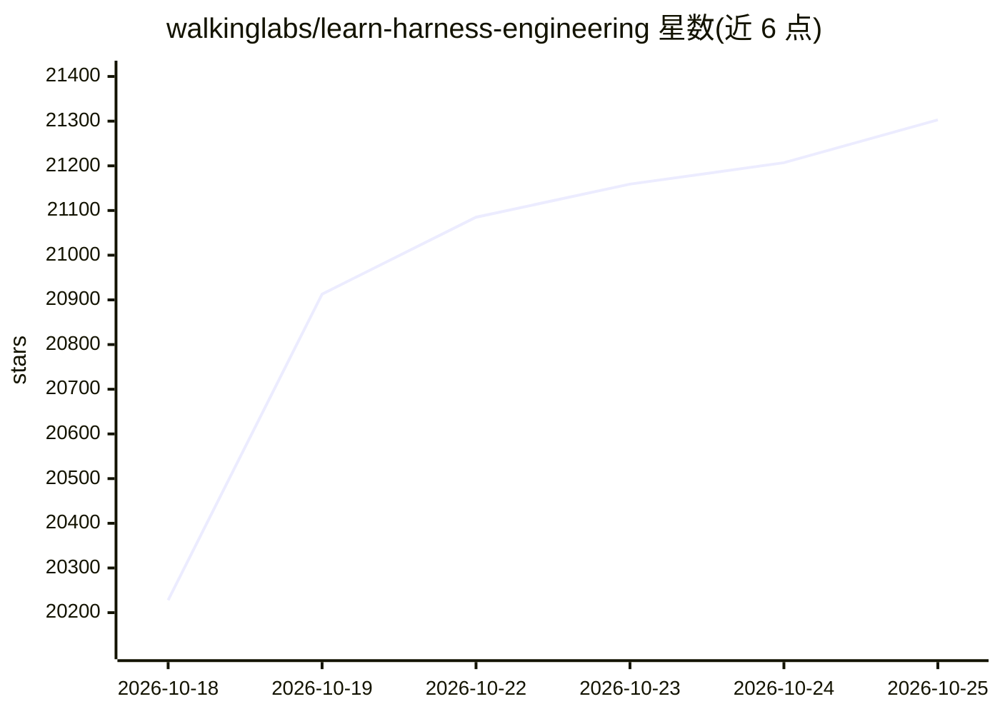

# walkinglabs/learn-harness-engineering

⭐ 21,303 · TypeScript · MIT · 推送 2026-10-22 · [GitHub](https://github.com/walkinglabs/learn-harness-engineering) · [官网](https://walkinglabs.github.io/learn-harness-engineering/) · 组织维护

**面向开发者的 AI coding agent harness 工程课程（14 讲+8 项目）**

以项目制课程形式讲解如何为 AI coding agent 构建运行环境（harness）：覆盖指令、状态、验证、范围、会话生命周期五个子系统，以及 loop engineering 与 graph engineering 等进阶主题。内容含 14 讲、8 个动手项目、可复制的模板资源库（AGENTS.md、feature_list.json、init.sh 等），全部课程材料以 MIT 许可发布并提供 15 种语言翻译，可通过 npm 脚本在本地生成 PDF 教材。毕设项目为一个 Electron 知识库桌面应用，随课程阶段演进。

## 筛选速览

| 维度 | 判定 | 备注 |
|---|---|---|
| AI 角色 | `ai-knowledge` | 知识聚合/清单类 |
| 许可风险 | `permissive` | MIT |
| 部署形态 | `library` | 以包/库形式分发 |
| 模型依赖 | — | README 未给出锁定关系 |
| 硬件要求 | — | 无带数字的原话,不猜 |
| 安装摩擦 | `low` | 无编译、无系统依赖或容器化 |
| 成熟度 | — | 结构信号不足 |

## 动量与使用信号

- 维护:`active` — 距上次 push 17.2 天,年发版 0,25 位贡献者
- 涨星:近 1 天 **+308**(自 20261016 起算)

## 能力要点

- harness 五子系统框架：指令、状态、验证、范围、会话生命周期
- 提供可复制模板库与 harness-creator 脚手架技能（AGENTS.md、init.sh、验证流程）
- 14 讲 + 8 项目，15 种语言翻译，MIT 许可
- 含 Claude Code、Codex、DeepSeek、Pi 四个生产 harness 的拆解章节

## 适用场景

- 学习如何在真实仓库中让 coding agent 可靠地完成多轮任务
- 为自己的项目搭建 AGENTS.md、状态文件与验证工作流
- 参考生产级 agent harness（Claude Code/Codex/DeepSeek/Pi）的设计方式

## 场景标签

`教程课程` · 领域:学习与行业

## 证据(README 行号)

> L19:  A project-based course on building the environment, state management, verification, and control mechanisms that ma
> L136: A harness has five subsystems:
> L187: 1. **Lectures**: 13 conceptual units explaining the theory behind harness engineering.
> L188: 2. **Projects**: 7 hands-on projects where you build an agentic workspace from scratch.

## 星数曲线

2026-10-18 20,228 → 2026-10-25 21,303（+1,075）

---
*卡片 v1 · prompt 1.4 · 生成 2026-10-18 · 置信度 high · 依据 README sha `58eb016e442d` · [字段定义](../../DATASET.md)*
